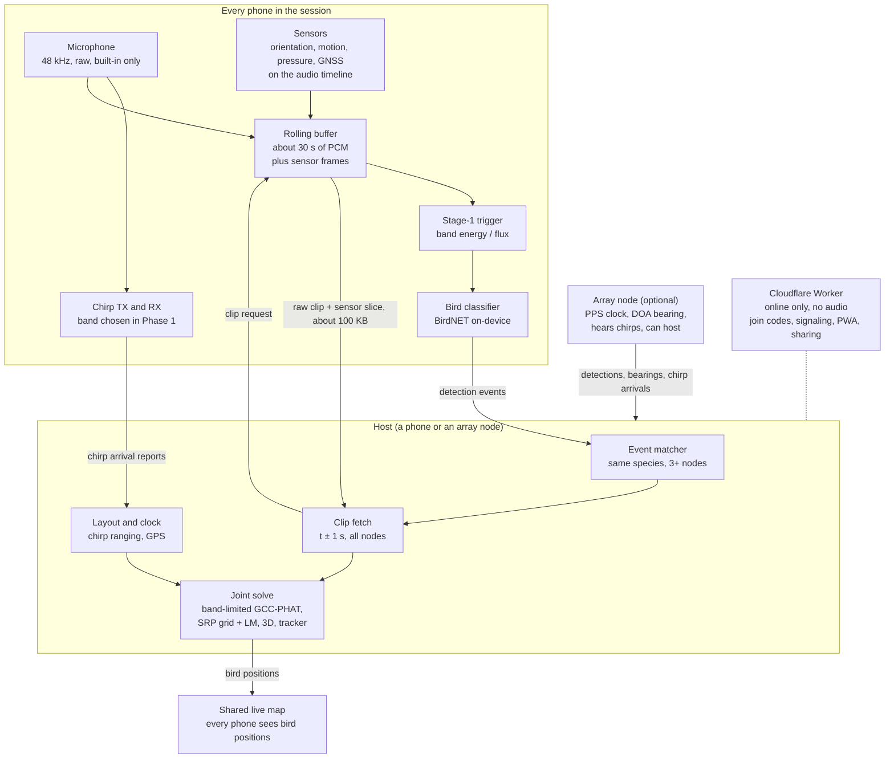

# MinimapPR Field Mode — Phone-Mesh Bird Localization Plan

## Summary

Core use case: a group of birders (say 6 people) go into the woods. Most likely they still have cell service. The group is spread out a bit (likely in several clumps, often 2 or 3 people together). Together they connect their phones and get localized bird detections to help them spot birds.

If just a single user is online, it won't be able to do localization, but it could still send notifications as they hike as it picks up birds. A common use case would be two users (a couple) hiking together. While not able to localize, it might still be nice if we could provide a bearing (ie it's north).

Another similar use case might be a group of security guards at a festival, using the localization for gunshot or drone localization.

All audio processing happens on the phones (and on any MinimapPR array node that joins); Cloudflare is our chosen cloud provider, and it handles only the minimal amount we need to (trying to keep to free tier or around $5/month for thousands of users). Local sessions (or hotspot sessions maybe) may never have to hit the cloud at all.

Given the phones are already connected, it might be useful to be able to send some sort of basic messages across the group as well (ie set a status or 'taking a break', 'heading home', 'request assistance' or something). However this would be a lower priority, secondary functionality.

Possibly we could explore the "federation" setup (ie if the group wanders too far apart, individual groups could continue to work independently, reconnecting into the whole group when possible. Federation would be a "nice to have" not "need to have" setup, and might not be worth the complexity.

Setup would need to be clean and easy. Likely tapping on which models they want active (ie birds vs drone detection). We'd probably need to clearly show connections (ie if enough nodes are active close together enough for localization).

Aim to consume as minimal power as feasible (obviously running TDoA and quantized neural nets still is going to use a decent bit of power for any main server, but we should keep it as minimal as practical). One good way to do this is if the group is still on cell service, send everything back to an at-home plugged in MinimapPR server (say a laptop). But that might rack up high data usage if sending lots of audio back, and not everyone has unlimited data plans, so not all users will want to use that option.

Key decisions:

- **Native app on Android; a PWA on iOS until there is an Apple developer account.** Recording phones must keep recording with the screen locked and must run offline sessions, which only a native app does reliably. The interim iOS PWA may be somewhat limited in functionality given PWA limitations.
- **Every phone processes its own audio; the host fuses.** Each phone keeps a rolling raw-audio buffer, runs a cheap activity trigger, and classifies locally only when the trigger fires. The host pulls short raw clips (about ±1 s) only when a detection fires, then localizes the call.
- **Sound and GPS, sets geometry and timing.** Phones chirp to each other at high frequency, which gives centimetre distances and sample-level clock offsets. The chirp band is picked in Phase 1, favouring what birds can't hear over what people can't hear. Phone localization (GPS) may only be accurate enough to place the whole layout on the map. Users will want a setting to turn chirps off (or force to ultrasonic) if it annoys them.
- **One timebase, and the platform's own sensor fusion.** On each phone, audio, motion sensors and GPS all sit on one monotonic OS clock (Android `CLOCK_BOOTTIME`, iOS host time), never the wall clock. Orientation, steps and pressure come from the platform's fused sensor APIs rather than our own filters. Onboard multi-mic capture is used only where the OS confirms raw channels and the mic positions are known; users never enter measurements.
- **Mixed node types from the start.** Phones and MinimapPR array nodes (tetrahedral, XVF3800) share one node descriptor and one solver that combines time-difference (TDOA) and direction (DOA) measurements. A portable array node can also anchor the mesh to UTC and host the session.
- **One shared Rust core.** Localization, sync and fusion code is shared with the MinimapPR Linux server through a mobile-safe Rust crate, wrapped for Android (and later iOS) through UniFFI and compiled to WASM for the iOS PWA.
- **Local networking first.** Use an Android host's local-only hotspot or a portable array node's access point when one is present, Network.framework peer-to-peer for all-iPhone groups (native iOS, later), Wi-Fi Aware for mixed groups once proven, and WebRTC via Cloudflare signaling when there is cell signal.
- **Design for Latest Firmware.** Target Android 16 and later. Older backwards compatability is nice to have, but not worth bringing in large complexity to handle. iOS 26 and newer. We expect Pixel phones will be our main test case.

The largest technical risk is sound-based clock sync on stock phones. Phase 1 tests it with two Android phones (plus one iPhone in Safari) before anything else is built. The second risk is the iOS PWA reaching an offline local host from a browser.

## Requirements and non-goals

The target is "which tree" accuracy (about 1–3 m) for birds 5–50 m away, with 3–8 phones, fully offline.

| Requirement | Target | Why |
| --- | --- | --- |
| Localization accuracy | 1–3 m horizontal inside the phone layout; bearing-quality outside it | Enough to point at a tree; matches the earlier error budget |
| Group size | 3 phones minimum, 4 recommended, up to about 8; or 1 array node + 2 phones | 3 is the 2D minimum; 4 adds a check and outlier rejection; an array node's bearing replaces phones |
| Inter-phone clock sync | Better than 100 µs (sample-level, about 21 µs at 48 kHz) | 1 ms sync already costs about 0.7 m |
| Relative phone geometry | About 10 cm, refreshed every 5–30 s and whenever the group stops | Phones move as people walk |
| Connectivity | Works with no internet or cell signal | Woods |
| Platforms | Android native; iOS as a foreground PWA first, native iOS later; mixed groups | Real birding groups are mixed; no Apple developer account yet |
| Audio leaving the phone | Only short clips to the host, inside the session | Privacy and bandwidth; no cloud audio |
| Cloud | Cloudflare Workers for join codes, signaling, model downloads, PWA hosting, post-session sharing | Cheap, small transactions only |
| Battery | At least 3 h of session on a typical phone; host may need a power bank | Morning walk; two-stage triggering keeps the classifier idle most of the time |
| Detection band | Full bird band, 48 kHz capture, no OS voice processing, built-in mic pinned | Many songbirds sit at 3–8 kHz; Bluetooth headsets drop input to 8–16 kHz |

Non-goals for the first release:

- Long-range (beyond about 100 m) or kilometre-scale localization; that stays with fixed MinimapPR nodes.
- Recording or archiving audio beyond the rolling buffer, except clips the user saves on purpose.
- iPhone hosting of any session before native iOS exists; iPhone hosting of mixed groups before Wi-Fi Aware interop is proven.
- A PWA that records in the background or with the screen locked. The interim iOS PWA records only in the foreground with the screen on.
- Cloud processing of any kind.

## System architecture

Every phone is a node; one device is also the host, either a phone or a portable array node. Phones keep raw audio to themselves and send only small messages, until the host asks for short clips of a call several phones heard.



Each phone sends detection events and chirp reports. When 3 or more nodes hear the same species within the time window, the host fetches ±1 s clips from all of them, solves the position and pushes it to every map.

**Roles.**

- **Node (every phone):** capture, rolling buffer, Stage-1 trigger, on-device classification, chirp send and receive, local map display.
- **Array node (optional, MinimapPR tetrahedral or XVF3800):** PPS-locked capture, per-call DOA bearing, passive chirp listening, and, for a Linux/Pi backpack node, the Wi-Fi access point and host role.
- **Host (an Android phone with a power bank, or a portable array node):** runs the transport, schedules chirps, keeps the layout and clock models, matches events, fetches clips, solves positions, runs the tracker, and keeps the session event log.

**Load.**

- One clip is 1–2 s of 48 kHz 16-bit mono, about 96–192 KB per phone per call. A busy dawn chorus at one localized call per second with 6 phones is roughly 1 MB/s at the host: fine on WiFi, too much for Bluetooth.
- Six phones make 15 pairs. Band-limited GCC-PHAT on 1–2 s clips plus an SRP grid search and LM refine takes well under 100 ms per call on a recent phone (see Localization solver).
- When calls arrive faster than the host can process, it drops the oldest pending call and counts the drop (the backpressure pattern from the audio app and MinimapPR's classification queue).
- Classification runs on every phone, so the host does no more inference than any other node.

## Acoustic self-survey and clock sync

Phones measure their distances and clock offsets by chirping to each other; GPS only anchors the result on the map. Phone OS audio timestamps are unreliable (input latency jitter, callbacks up to about 100 ms late), so every timing measurement is a sample count on the phone's own audio clock. A coarse mapping from sample count to the OS clock (the clock anchor, see Phone sensors and timebase) places events within milliseconds for matching and clip requests, but never enters a TDOA.

**Two-way ranging.** Phone A chirps, then phone B. Each phone records both chirps and counts the samples between them on its own clock. The BeepBeep form includes each phone's own speaker-to-mic distance, $d_{AA}$ and $d_{BB}$:

```math
d_{AB} = \frac{c}{2}\left[(t_{A,2} - t_{A,1}) - (t_{B,2} - t_{B,1})\right] + \frac{d_{AA} + d_{BB}}{2}
```

Leaving that term out biases every distance by half the summed speaker-to-mic distances. The distance depends on which speaker and mic the phone uses (a bottom speaker sits 1–2 cm from the bottom mic; the earpiece is 12–15 cm away), so the app keeps a per-model $d_{ii}$ table, which we calibrate once per model against a tape-measured 1 m pair (users never do this).

The same two arrival pairs also give the clock offset between A and B, since the two flight times are equal. The offset and the distance come from one exchange, the same way UWB two-way ranging works.

**Chirp design.**

- **Band, chosen in Phase 1 for birds first.** The Phase 1 harness sweeps 18–20 kHz, 15–18 kHz and 12–16 kHz. 18–20 kHz loses the most: air absorbs about 0.4–0.6 dB/m (roughly 10–15 dB over 30 m), phone speakers beam narrowly at a 1.7 cm wavelength, and many OEM audio paths roll off above 16–18 kHz even in `UNPROCESSED` mode. Published phone ranging at these frequencies mostly tops out at 5–25 m indoors. Most songbirds hear poorly above about 8–10 kHz, so 12–16 kHz is preferred when it ranges clearly further, even though people under about 40 will hear a faint tick. Audible 2–6 kHz chirps are the last resort because birds hear them.
- **Long and quiet, not short and loud.** A phone's own mic sits about 1 cm from its speaker, so a full-scale burst can clip the self-recording or trip a hardware limiter or AGC, which distorts the $t_{A,1}$ peak. Use longer chirps at lower level (more time-bandwidth product gives the same matched-filter gain), and measure self-recording headroom per model in Phase 1. A phone with verified stereo capture (see Onboard multi-mic) records its own chirp on the mic farthest from the speaker: 12–15 cm away it hears the chirp roughly 15–20 dB quieter, so the chirp level can stay higher. $d_{ii}$ is then the distance to that mic.
- **Doppler-tolerant waveform.** A linear FM sweep turns a Doppler shift into a timing error: about 70 Hz at 20 kHz for 1.2 m/s of relative motion, which shifts the peak by several milliseconds for a 100 ms, 2 kHz sweep. Phase 1 compares linear FM against hyperbolic FM (Doppler-invariant), with a per-phone code so overlapping arrivals can be told apart.
- **First arrival, not strongest peak**, because reflections can be stronger than the direct path.
- **Speed of sound from temperature** (phone sensor if present, otherwise weather fetched at session start); 1 °C error is about 0.18% distance error.
- **Chirps are masked out of detection.** At 12–16 kHz the chirps fall inside the 48 kHz capture band. The host knows the schedule, so each phone blanks scheduled chirp windows before the Stage-1 trigger and classifier, and the clip solver's band limit (2–8 kHz typical) excludes them.

**Schedule.** The host assigns chirp slots round-robin, one phone per slot. Phones do not chirp at the same time even with orthogonal codes: a phone's own speaker 1 cm from its mic drowns a distant phone's chirp (the near-far problem). A full round with 6 phones at 0.4 s per slot takes about 2.4 s; shorter Doppler-tolerant chirps should bring that under about 1.5 s. Rounds run:

- periodically, every 5–30 s, as a baseline;
- immediately when the phones' accelerometers show the group has stopped walking (birders stop when they hear a bird);
- right after a detection. The clock model is offset plus rate, so a round a second or two after the call can be applied backwards to the call's already-buffered audio, provided the phone has had no sample gap since. The host localizes at once with the current model and refines the position when the post-detection round lands.

During a round, phones whose accelerometers show walking are down-weighted or skipped. What matters is relative motion between phones: a group walking together moves much less relative to each other than the 2.9 m each person covers in a 2.4 s round, but it is still enough to break the rigid-layout assumption.

**Clock model.** Each round updates a per-phone clock model (offset plus rate, since crystals drift tens of ppm). Any gap in a phone's sample stream, or any audio route change or session interruption, invalidates its model until the next round.

**Clock-rate correction inside each clip.** A rate offset stretches the clip as well as shifting its start: 50 ppm over a 2 s clip is 100 µs (about 4.8 samples at 48 kHz) from start to end, which smears the GCC-PHAT peak. Before correlation, the host resamples each clip to the reference clock using that phone's tracked rate (fractional resampling, or a linear phase correction in the STFT domain).

**Layout solve.** Pairwise distances feed a multidimensional-scaling initial guess, then a robust least-squares refine that rejects bad pairs. The result is a rigid layout in a local frame with per-phone uncertainty. It is mainly 2D, with relative phone heights from barometers (see Phone sensors and timebase) so sloped trails don't distort it. GPS altitude is often 15–30 m off and mixes ellipsoid and geoid heights across devices, so it is used only, with a wide uncertainty, for a phone with no barometer. An array node that hears the chirps but doesn't transmit enters the solve as a listen-only node (see Localization solver).

**Map anchoring.** The chirp layout is rigid to about 10 cm, so the whole group has only three map unknowns: east, north and rotation. Fit the layout to every phone's GPS fix at once with a weighted robust fit (Umeyama/Kabsch with a Huber loss). Each fix is weighted by its reported accuracy, inflated by its GNSS quality score (see Phone sensors and timebase), because under trees the reported accuracy is often optimistic. Under canopy a fix may be 5–15 m off from trunk reflections. That error differs from phone to phone, so the robust fit rejects the one phone standing under a dense hemlock instead of averaging it in. The fit also gives the layout's rotation, so with 3 or more phones spread 15 m or more, phone compasses are optional.

A slow filter then smooths the three anchor parameters over time. Multipath does not average out while the group stands still (trees and satellites barely move in 30 s). So when the step detectors and GNSS Doppler speed say everyone is still, the filter's process noise drops to near zero and a sudden GPS jump cannot drag the map. Fixes taken in clearings (strong signal, L5 lock) tighten the anchor, and the group coasts on them through dense woods.

A map anchoring error shifts every bird on the map equally; it does not blur positions relative to the phones. An array node with a surveyed position and orientation anchors the map directly. Two phones cannot get their rotation from GPS, because a 3–5 m baseline is far below GPS error; see Couples under Localization solver.

**What can break it.**

- Phones in pockets block high-frequency chirps. The app shows a per-phone "hearing quality" score and a "set your phone down" prompt. The prompt asks for the phone screen-up on a log, rock or pack with the mic ports clear. A mic within about 1 cm of a hard surface gets direct and reflected sound in phase, up to about 6 dB louder, with no ground-bounce notches. While walking, a chest strap or shoulder-strap clip beats a pocket by a wide margin above 4 kHz. A phone that misses rounds falls back to detection-only mode (no position).
- Audio route changes. Bluetooth earbuds, a smartwatch or a phone call can silently switch input to an 8/16 kHz Bluetooth HFP mic or interrupt the audio session. The app pins the built-in mic (`AudioRecord.setPreferredDevice` on Android, `AVAudioSession.setPreferredInput` on native iOS). It treats any route change or interruption as a hard clock-model invalidation and shows it to the user. The iOS PWA cannot pin input; it watches for `devicechange` and track `mute`/`ended` events instead.

## Phone sensors and timebase

Each phone puts audio, motion sensors and GPS onto one monotonic OS clock (Android `CLOCK_BOOTTIME`, iOS host time), never the wall clock, and takes fused values from the platform APIs rather than building its own filters. API choices, onboard multi-mic details, and what was considered and not adopted are in [field_mode_phone_sensors.md](field_mode_phone_sensors.md).

- **Clock anchor.** Each phone fits OS time against its sample index over a sliding window. That places sensor frames on the audio timeline, flags dropped buffers, and gives the host coarse alignment for matching and clip requests. An unknown per-model audio pipeline delay (often 5–40 ms) keeps it out of TDOA, which stays with chirps.
- **Sensor frames.** A 25–50 Hz ring buffer (orientation, motion level, pressure, GNSS fix and quality) sits beside the PCM buffer, and every fetched clip carries its matching slice.
- **Orientation.** Android `TYPE_ROTATION_VECTOR` and `TYPE_GAME_ROTATION_VECTOR`, which work in a foreground service (Google's Fused Orientation Provider updates only in the foreground); `CMDeviceMotion` on iOS. With 3 or more phones the layout fit sets the group's rotation, so phone heading matters only for stereo phones and couples.
- **Motion.** The step detector and linear acceleration give the walking/still state for chirp rounds, and a handling score that blanks grip and footstep transients before Stage 1. Stage 1 is never switched off while walking.
- **Pressure.** Relative heights from barometers, with each phone's offset recorded when it joins (the joiner is standing next to the host to scan the QR code).
- **GPS.** Android `GPS_PROVIDER` (independent fixes) feeds the anchor fit, weighted by a GNSS quality score (satellites used, C/N0, L5 lock). This is provisional; Phase 3 field data compare it with the fused provider.
- **GnssClock (Android).** A Phase 1 measurement: whether it can hold an audio clock rate across missed chirp rounds.

## Localization solver

The host turns a matched call into a position with one solver shared with the MinimapPR server. It is designed for forest conditions: tonal calls, strong reflections, several species singing at once, and birds 10–30 m up in the canopy.

**Match by species and time.** A dawn chorus has several species singing within the same ±1 s window, so the event matcher groups detections by `(species_id, time_window)`, not just "3+ phones heard a call". Correlating clips of different birds produces confident nonsense.

**Band-limited GCC-PHAT.** Full-band PHAT weights every frequency equally, which boosts wind below 1 kHz and insect and thermal noise above 10 kHz, and lets tonal whistles lock onto an adjacent period (cycle skipping). The solver limits PHAT weighting to the call's active band $[f_{\min}, f_{\max}]$. The band comes from a species prior, narrowed by a spectral-energy mask on the clip itself. This matches the server's measured finding that a wide PHAT band can reverse a bearing (see `project_localization_band_phat_ceiling`).

**Loop-consistency filter.** Before solving, drop TDOA triples whose loop does not close, $\tau_{AB} + \tau_{BC} + \tau_{CA} \approx 0$ within the expected error. This rejects pair peaks that locked onto a reflection (as in CARDINAL).

**Distributed SRP-PHAT, then LM refine.** In heavy foliage, single pairs often have a stronger reflection peak than direct-path peak, so committing to each pair's argmax TDOA and then running Levenberg–Marquardt fails in exactly the cases that matter. Instead, the solver sums every pair's full GCC-PHAT curve over a spatial grid around the group, takes the global maximum, and refines it with LM. Only the 4-mic tetrahedral geometry in `src/srp_phat.rs` is phone-specific; the algorithm generalizes to any node layout.

- Cost: a 100 m × 100 m area at 2 m spacing is 2,500 cells; with 8 height layers and 15 pairs that is about 300,000 table lookups into precomputed GCC arrays, a few milliseconds in Rust.
- Coarse-grid catch: a band-limited PHAT peak is only about 0.2 ms wide (about 6 cm of path difference), while a 2 m cell spans up to 2 m of path difference. At the coarse level, each cell takes the maximum of each pair's GCC over the TDOA interval the cell spans (or a smoothed envelope), then the grid is refined around the best cells.
- Phase 3 compares SRP-then-LM against argmax-TDOA-then-LM on the same replay bundles and keeps whichever wins; the server's SRP-PHAT hardening item benefits either way.

**3D with a canopy-height prior.** A 2D solver that assumes the bird is on the ground squeezes canopy birds toward the array centroid and inflates residuals until valid overhead birds get rejected as outliers. The solver works in 3D with a soft prior on bird height above the local ground, $z \in [0, 35]$ m, and uses phone heights from the layout solve. A near-flat ground array sees height poorly and cannot tell above from below; the prior removes the below-ground mirror solution. The map shows the horizontal $(x, y)$ position with height marginalized out, and a horizontal covariance ellipse.

**Joint TDOA + DOA over mixed nodes.** Every node in a session describes itself:

```text
NodeDescriptor {
  geometry:    SingleMic | SubArray { mic_offsets_m },
  orientation: Fixed | Surveyed | Imu | Unknown,
  clock:       Pps | Ntp | AcousticChirp | Unsynced,
  position:    Fixed | Surveyed | AcousticMesh | Gps,
  has_speaker: bool,
}
```

All measurements go into one weighted nonlinear least-squares objective (a small factor graph, after Wang et al. 2024):

- TDOA residuals between any two nodes that share a clock model: phone–phone through chirp sync, phone–array through the array hearing chirps, array–array through PPS;
- DOA residuals (azimuth, elevation) from any array node, weighted by its bearing covariance;
- TDOA residuals between the two mics of a stereo phone: a cone around its mic axis, rotated into the world frame by the phone's orientation at the time of the call;
- optionally an effective speed of sound as a free parameter (as CARDINAL does).

This is why one portable array node helps a phone group so much:

1. **Passive UTC and geometry anchor, no speaker needed.** A PPS-locked array node that hears two or more phones' chirps joins the layout solve as a listen-only node. That ties the phone mesh's clock to UTC, enables TDOA between the array and every phone, and, with a surveyed position and orientation, anchors the map frame. Its own DOA of each chirp also fixes the layout's rotation.
2. **Breaks the geometry minimum.** A 4-mic array gives a 3D bearing without any inter-node sync, so 1 array node + 2 phones already gives a strong 2D/3D fix.
3. **Wi-Fi access point and host.** A Linux/Pi node in a backpack can run the access point and the host role. That takes the hotspot and power-bank burden off birders' personal phones, and it can serve the iOS PWA over valid HTTPS offline (see Networking). It speaks the same `minimappr-core` message enum and MMB3 clip framing as a phone host.

**Phones with two raw mics (opportunistic).** A phone whose OS confirms two raw channels with known mic positions (see Onboard multi-mic) joins as a 2-mic `SubArray` with `Imu` orientation. Nothing else in the solver changes. What it can and cannot do:

- Top and bottom mics sit about 15 cm apart, so the largest delay is about 440 µs (21 samples). Outdoors, with hands and the phone body diffracting sound, expect roughly ±8–15° near broadside, and worse toward the mic axis.
- Above about 1.1 kHz (half-wavelength spacing), a pure tonal whistle has several equally good delays. Broadband calls, trills, sweeps, drones and gunshots resolve to one.
- Two mics measure a cone around the mic axis, not a compass bearing. Held upright, that axis points mostly up, and a bird 45° up shrinks the delay by 30%. The solver therefore always uses the cone in 3D with the phone's orientation, never a flat azimuth.
- On its own, the cone has a mirror ambiguity; another measurement has to break it.

**Couples.** Two chirp-synced phones give a sharp inter-phone cone around the line between them, but that cone has its own mirror ambiguity, and GPS can't give the line's heading at 3–5 m. If one phone has stereo capture:

- it measures the direction of its partner's chirps, which gives the heading of that line (the broadband chirp resolves the spatial aliasing);
- its own cone on the bird crosses the inter-phone cone at a different angle, which usually leaves one consistent bearing from a single call;
- repeated calls, or the phone turning (tracked by the gyro), remove what is left.

With two stereo phones, the crossing gives a coarse position. All of this falls out of the normal residuals, with no special mode. A couple with two mono phones gets detections only, unless an array node joins.

## Networking and session model

The app tries local transports in a fixed order and only uses the internet for signaling. The host's event log is the source of truth, as in pcplayerpicker, where the coach device holds the full log and the server is optional.

| Group | Transport | Status |
| --- | --- | --- |
| Includes an Android phone | Android host creates a local-only hotspot from the app (`LocalOnlyHotspot`); others join over WiFi; a WebSocket server on the host carries messages | Proven APIs; build first. Test iOS joining it in Phase 2, not Phase 4: WPA3-only mismatches, 5 GHz channel quirks, and iOS dropping a no-internet network unless sockets are bound to it |
| Portable array node present | Linux/Pi node runs a Wi-Fi access point (hostapd + dnsmasq) and the host role | Standard Linux; same protocol as a phone host |
| All iPhones (native iOS, later) | Network.framework with `includePeerToPeer = true` (`NWBrowser`, `NWListener`, `NWConnection`) over peer-to-peer Wi-Fi | Apple's recommended replacement for MultipeerConnectivity ([TN3213](https://developer.apple.com/news/site-updates/?id=07142026a), July 2026; forum reports say MultipeerConnectivity is deprecated in Xcode 27). TCP needs message framing; the binary message enum already provides it |
| iOS PWA node (interim) | Browser page served by Cloudflare (online) or by a Linux host over HTTPS (offline); talks to the host over WebRTC data channels or a WebSocket | Spike in Phase 2; see below |
| Mixed, no Android or Linux host | Wi-Fi Aware: Android has had it for years; [iOS 26 added it](https://9to5mac.com/2025/06/20/ios-26-to-let-third-party-apps-build-their-own-airdrop-alternative/) for iPhone 12 and later; needs native iOS | Cross-platform links unproven; [developer reports](https://developer.apple.com/forums/thread/790195?page=2) show negotiation failures (DCEA/encryption) |
| Discovery and control fallback | Bluetooth LE advertising plus a small GATT service (native apps only) | Works across platforms; too slow for audio clips |
| Has cell signal | WebRTC data channels; Cloudflare Durable Object relays only the connection setup | Avoid TURN relays, which bill for the data they carry |

**Getting the iOS PWA to the host.** Browsers give the microphone only to secure pages (HTTPS or localhost), and a secure page cannot open a plain `ws://` connection to a local IP. That leaves three routes:

- **Linux host (array node):** the access point's DNS resolves a real hostname to the host, which serves the PWA and a secure WebSocket with a valid certificate renewed while online. This works fully offline and is the cleanest route.
- **Android host with cell signal:** the PWA loads from Cloudflare, and the host and PWA exchange WebRTC offers through the Durable Object. The data channel then runs over the hotspot LAN using host ICE candidates.
- **Android host, fully offline:** WebRTC with the offer and answer exchanged by QR code (host shows an offer, iPhone shows an answer). Workable but clunky; the Phase 2 spike decides whether it is good enough or whether offline iPhone users need a Linux host.

**Session and join flow.**

1. The host taps "Start session". The app creates a session ID, a 128-bit join token and a host key, then shows a QR code holding the session ID, token, transport hint and (for the hotspot or access point) WiFi credentials, plus the PWA URL for iPhones.
2. Joiners scan the QR code. The app (or PWA) joins the hotspot or peer group, connects to the host and authenticates with the token.
3. If online, the host also registers the session with the Cloudflare Worker so late joiners can use a short join code instead of the QR code.
4. The host assigns a node ID and chirp slot, and records the joiner's node descriptor; the joiner starts chirping and streaming detection events.

**Host handover.** The host keeps an append-only event log (detections, layout updates, localized birds) with monotonic sequence numbers, the same cursor pattern pcplayerpicker uses (`events?since=N`). Every phone mirrors it. If the host leaves, the next eligible device by join order takes over from its mirror and re-creates the transport. An iOS PWA is never eligible. On the hotspot path, everyone must rejoin the new hotspot, which the app does automatically.

**Cloudflare scope.** Patterns to take from pcplayerpicker's Worker (`server_cloudflare/src/lib.rs`):

- One Rust Worker deploy serving the static site, the iOS PWA and the small API.
- Separate tokens per role (host vs joiner vs view-only), carried in links and QR codes.
- D1 tables with cron TTL cleanup (sessions expire after 24 h).

What this app needs that pcplayerpicker lacks: a Durable Object with WebSocket hibernation for live WebRTC signaling (polling D1 is too slow), and R2 for model downloads. Post-session sharing (a static map plus species list, optional eBird export) goes through D1 the pcplayerpicker way.

**Message protocol.** Use a single versioned message enum defined in the shared Rust crate and serialized with a compact binary format (postcard or CBOR). Message kinds: join and auth (with node descriptor), chirp schedule, chirp arrival reports, detection events, DOA bearings, clip requests and clip payloads (each carrying its sensor-frame slice), layout and clock models, localized-bird updates, and heartbeats. Clips travel as raw 16-bit PCM; lossy codecs would distort timing.

## Code reuse map

The shared piece is a new Rust crate, `minimappr-core`, used by the Linux server, the Android app and (as WASM) the iOS PWA. Today the sidecar is a single binary crate with every module declared in `main.rs`, and the multi-node solver, association and tracking live only in Python, so sharing means extracting some code and porting the rest to Rust behind parity tests.

| Capability | MinimapPR today | Plan for `minimappr-core` | Server benefit |
| --- | --- | --- | --- |
| Pairwise GCC-PHAT with sub-sample delay | `minimappr-ingest-sidecar/src/gcc_phat.rs` (std, rustfft, serde only) | Move; add band-limited weighting and in-clip clock-rate correction | Sidecar depends on the crate |
| DSP helpers, windows | `src/dsp_math.rs` | Move as is | Same |
| Timestamp-aligned ring buffer with gap handling | `src/dsp.rs` (`SensorStreamBuffer`) | Move; becomes the phone's rolling buffer | Same |
| Preprocessing (DC block, Butterworth high-pass) | Inside `src/dsp_worker.rs` (tokio-bound), around `butter_highpass_sos` | Extract into a plain module | Untangles the worker |
| SRP-PHAT grid search | `src/srp_phat.rs` (tetrahedral mic geometry baked in) | Generalize to arbitrary node layouts; coarse-to-fine grid feeding LM | Same code serves the server's SRP hardening item |
| Multi-node TDOA solve with covariance | Python only: `minimappr/core/cartesian_tdoa.py`, `core/tdoa_measurements.py`, `core/localization_uncertainty.py` | Port to Rust (nalgebra + Levenberg–Marquardt); 3D with height prior; loop-consistency filter | Server can call it via the sidecar or PyO3 |
| Bearing fusion and joint TDOA + DOA | Python: `core/multi_node_bearing_fusion.py` | Port in Phase 2 as the DOA term of the joint solver | Same |
| Event association across nodes | Python: `core/fusion_node.py`, `core/cluster_registry.py` | Port the association rules only, not the orchestrator; key on species + time window | Same |
| Tracking (Kalman, association) | Python: `core/tracking.py`, `core/track_filters.py`, `core/track_associators.py` | Port the 6D constant-velocity filter and nearest-neighbour associator | Same |
| Node GPS averaging | Python: `core/node_position_estimator.py` (KDE over fixes) | Replace with the rigid layout-to-GPS fit | Applies to fixed nodes too |
| Chirp ranging, clock models, layout solve | Does not exist | New code, including listen-only array nodes | Fixed nodes with speakers can self-survey too |
| Node descriptor | Implicit in `NodeOrientation`, `TimeQuality` | New type shared by every node kind | One description for fixed and mobile nodes |
| Wire format | `minimappr/api/binary_ingest.py` (MMB2/MMB3: node block, GPS, ns timestamps, sample indices, `TimeQuality`, PCM16); Rust parser in `src/audio_payload.rs` | Reuse MMB3 framing for clip payloads | A phone can also stream to a fixed MinimapPR server as a node |
| Data models | `minimappr/models.py` (`GeoPoint`, `NodeOrientation`, `TimeQuality`, `DetectionEvent`, `LocalizationResult`, `TrackState`) | Mirror as Rust serde types | One schema for both |

Not reusable for phones: `render_mvdr.rs` and the beamforming renders assume the 4-mic tetrahedral node (`SIRITH_MIC_POSITIONS_M`). Server/IO modules (`main.rs`, `ingest_backend.rs`, axum, rusqlite, tokio `process`) stay in the sidecar. Once the DSP files move out, the crate should build for `aarch64-linux-android`, `aarch64-apple-ios` and `wasm32-unknown-unknown`; none of these builds has been tried yet. The WASM build needs threads and SIMD kept optional.

**Sans-IO core.** The node and host logic in `minimappr-core` (sync scheduler, event matcher, clip fetcher, solver, tracker, event log) is written as state machines that take inputs (audio blocks, messages, timer ticks) and return outputs (messages, timers), with the clock, random-number source and transport injected. There is no tokio and no wall-clock access in the core. The Android shell, the WASM PWA, a Linux array-node host and the deterministic mesh simulator all drive the same code.

**Parity tests.** MinimapPR already runs cross-language parity tests (`tests/test_localization_cross_language_parity.py`, `src/dsp_worker_tests.rs`, golden `.npz` files in `tests/fixtures/`). Every ported function gets a parity test against its Python original before the phone uses it. Relevant suites: `test_cross_node_tdoa.py`, `test_tracking.py`, `test_multi_node_bearing_fusion.py`, and the replay harness in `minimappr/sim/replay.py` with bundles from `minimappr/calibration/bundle.py`.

**Classification.** MinimapPR runs BirdNET 2.4 as TFLite through `ai_edge_litert` (`minimappr/classifiers/birdnet.py`); there is no BirdNET or YAMNet ONNX in the repo.

- **Licence.** BirdNET v2.4 models are CC BY-NC-SA 4.0. The app will be distributed free and non-commercially, which this allows with attribution. Converted or sliced model files (ONNX, a regional label subset) carry the same licence. Ads, a paid tier or a commercial sponsor would break the non-commercial term and force a model change.
- **Runtime.** On Android, start with LiteRT: it runs BirdNET's native format, and the audio app's NPU→GPU→CPU fallback already works. Convert to quantized ONNX (as AGENTS.md prefers) as a parity-tested task, checking accuracy against the TFLite model on the replay bundles. The iOS PWA needs a browser runtime: ONNX Runtime Web (WASM/WebGPU) on the converted model, or LiteRT's web build. The Phase 2 spike picks whichever is faster on a recent iPhone.
- **Two-stage triggering.** Running BirdNET every 1–3 s on every phone causes thermal throttling and drains batteries. A cheap Stage-1 trigger in `minimappr-core` (band-limited 1.5–10 kHz energy contrast and spectral flux against a running noise floor) wakes the classifier only when there is likely biological sound. The threshold is relative to the noise floor, not an absolute level, so faint distant birds still pass (AGENTS.md: don't block faint detections with RMS gates). MinimapPR's texture-gate work found energy contrast to be the useful discriminator. Rejects are counted, and BirdNET runs on 1 in N rejected windows to measure what Stage 1 misses.
  - The trigger band follows the active mode. It is 1.5–10 kHz for birds, which also keeps wind (mostly below 500 Hz) out of the noise-floor tracker. It drops to about 80–100 Hz at the low end for drones and gunshots, whose rotor fundamentals and blast energy sit low.
  - Handling transients flagged by the motion sensors are blanked before the trigger (see Phone sensors and timebase).
- **Host re-classification (Phase 5 experiment).** The host already holds time-aligned clips of each localized call from 3–8 phones. Stacking them (a weighted or median STFT stack) suppresses each person's own footsteps, rustle and wind, and BirdNET on the stack may rescue faint species IDs. The gain will be well below the ideal +6 dB for 4 phones, because forest reverberation and leftover alignment error decorrelate the higher frequencies. It is measured on golden bundles against simple per-phone score fusion (as the server's cross-node late fusion does) and ships only if it wins. It needs phones to forward low-confidence detections to the matcher, which stays off until then.
- **Alternative.** Google Perch v2 ([code](https://github.com/google-research/perch) Apache 2.0; weights reported Apache 2.0 by third parties, to confirm on the Kaggle listing) covers more species, with community ONNX conversions. It is heavier on phones; it would need its output head sliced to a regional species list, INT8 quantization, and the Stage-1 gate. Keep it on file in case distribution ever becomes commercial.

**Map.** The MinimapPR frontend (`minimappr-frontend/`, Leptos 0.8 CSR, MapLibre GL vendored in `vendor/maplibre`, layers in `src/layers/` for nodes, detections, tracks and uncertainty) is reusable in the Android WebView and as the iOS PWA, if a small local shim replaces `src/api.rs` and `src/ws.rs`. The existing `src/mock/` module shows where that seam is. In the Android WebView, the shim talks to the Rust core through WebView message channels (`WebViewCompat.addWebMessageListener`, `WebMessagePort`), not a localhost HTTP or WebSocket server. Android 17 gates local-network traffic behind a runtime permission and adds a separate `USE_LOOPBACK_INTERFACE` permission whose behaviour is not yet documented; a message channel needs neither. Offline map tiles must be downloaded before a trip (MapLibre supports offline regions; the PWA caches tiles in a service worker or OPFS).

**App shell.**

- **Android: Kotlin Multiplatform + Compose.** Matches the audio app's stack and its proven Android capture code. Audio capture, hotspot and the foreground service stay native; PCM buffers go to Rust through UniFFI (Gobley offers KMP bindings). The map is the Leptos frontend in a WebView, or MapLibre Native. The KMP project keeps an iOS target so a native iOS app can follow without restructuring.
- **iOS, interim: Leptos PWA.** The same Leptos frontend plus `minimappr-core` compiled to WASM, with capture through `getUserMedia` and an `AudioWorklet`. No Apple developer account is needed.
- **iOS, later: native.** A Swift or KMP shell over the same UniFFI bindings once there is an Apple developer account. A free account can already sideload to your own device through Xcode (7-day provisioning), which is enough for the Phase 4 Network.framework and audio-route spikes.
- **Tauri 2 is dropped.** It adds nothing to the PWA, still needs an Apple account to put a native app on an iPhone, and leaves capture, hotspot, Network.framework and Wi-Fi Aware as native plugins of the same size.

**From pcplayerpicker** (patterns, not code): Cargo workspace with feature-gated shared crate (`app_core` keeps heavy math out of the Worker), protocol types shared between client and Worker, role tokens in QR codes (`qr_svg` in `client_app/src/pages/coach/dashboard.rs`), and local-first state in IndexedDB/OPFS for the PWA.

## Platform specifics

Android and native iOS both allow continuous raw capture with the screen locked, but only from a native app with the right background mode. The interim iOS PWA records only while it is in the foreground with the screen on.

| Concern | Android | iOS native (later) | iOS PWA (interim) |
| --- | --- | --- | --- |
| Capture API | `AudioRecord`, or AAudio through Oboe if callback timing matters | `AVAudioEngine` input tap | `getUserMedia` + `AudioWorklet` |
| Raw audio | `UNPROCESSED` source when `PROPERTY_SUPPORT_AUDIO_SOURCE_UNPROCESSED` is true; else `VOICE_RECOGNITION` (the compatibility definition requires noise reduction and AGC off by default); else `MIC`, whose voice-tuned noise suppression can attenuate tonal whistles | `AVAudioSession` category `.playAndRecord`, mode `.measurement` (turns off voice processing) | Constraints `echoCancellation`, `noiseSuppression`, `autoGainControl` all false; full-band response unverified |
| Sample rate | 48 kHz mono, 16-bit or float | 48 kHz mono | `AudioContext` at 48 kHz (check what Safari actually delivers) |
| Mic pinning | `AudioRecord.setPreferredDevice` (built-in mic) | `AVAudioSession.setPreferredInput` | Not possible; detect `devicechange` and invalidate |
| Mic geometry | `AudioRecord.getActiveMicrophones()` (`MicrophoneInfo`), else the curated per-model table; stereo only when verified | Mono, primary mic | Mono |
| Simultaneous chirp playback | `AudioTrack` on the speaker while recording | Same session; force the speaker output route | Web Audio output while capturing |
| Background | Foreground service of types `microphone` and `mediaPlayback`, started while the app is in the foreground, with a persistent notification. Android 17 blocks background playback, audio focus and volume calls without one (apps targeting API 37 need a while-in-use service), sometimes silently, so chirps could stop when the screen locks | `UIBackgroundModes: audio` | None; Screen Wake Lock keeps the screen on, and locking the phone stops capture |
| Permissions | `RECORD_AUDIO`, `FOREGROUND_SERVICE_MICROPHONE`, `FOREGROUND_SERVICE_MEDIA_PLAYBACK`, `POST_NOTIFICATIONS`, location, `NEARBY_WIFI_DEVICES` (hotspot and Wi-Fi Aware), `ACCESS_LOCAL_NETWORK` (runtime; Android 17 blocks LAN traffic, including the hotspot WebSocket, for apps targeting API 37 without it) | Microphone, location, local network | Microphone and location, per site |
| Local hosting | `LocalOnlyHotspot` plus a WebSocket server | Cannot create a hotspot from an app; joins only, or Network.framework peer-to-peer | None; node only |
| Sample continuity | Count samples read; flag any overrun as a gap | Count frames per tap buffer; flag discontinuities in buffer timestamps as gaps | Count worklet frames against `AudioContext` time; browsers can drop blocks silently, so re-sync often |

**Onboard multi-mic (Android, opportunistic).** Most phones have 2–4 mics, but the OS often hides them. Full rules are in [field_mode_phone_sensors.md](field_mode_phone_sensors.md#onboard-multi-mic-android-opportunistic).

- Raw channels are never summed without alignment: 15 cm spacing notches the bird band and doubles every arrival. Phase 1 checks which capsule each phone's mono capture uses, since a HAL that mixes capsules leaves the acoustic centre unknown.
- A phone counts as stereo only when `getActiveMicrophones()` shows two directly mapped channels, both mic positions are known (from `MicrophoneInfo`, else a curated per-model table built from manufacturer drawings or teardowns and checked by us), and the channels really differ. Users never enter mic positions.
- Uses: a 2-mic `SubArray` bearing, recording the phone's own chirp on the far mic, and picking the less windy channel for the classifier. TDOA always uses one named mic. iPhones stay mono.

**Starting point on Android.** The on-device audio app (`audio_app/On Device Audio App/`) already has:

- the `UNPROCESSED`-with-`MIC`-fallback capture (`app/.../audio/source/AndroidAudioCaptureSource.kt`), which gains the `VOICE_RECOGNITION` middle step
- 48 kHz recording on `Dispatchers.IO` (`recording/AudioRecordingSession.kt`)
- an NPU→GPU→CPU LiteRT fallback (`inference/LiteRtCnnClassifier.kt`)
- drop-a-window-and-count-it backpressure (`InferenceController.kt`)
- a shared mel-spectrogram pipeline in `shared/commonMain/audio/pipeline/`

It has no foreground service, no networking and no iOS target, and its `app/` module duplicates `shared/` instead of depending on it. The field app should start from a clean KMP project with an iOS target and a single shared module, copying those pieces in rather than inheriting the duplication.

**PWA limits (why Android is native and the iOS PWA is interim only).**

- An installed iOS web app [loses the microphone when backgrounded or locked](https://bugs.webkit.org/show_bug.cgi?id=236509); Android browsers suspend background tabs too.
- A PWA can't create a hotspot, can't use Bluetooth on iOS, and can't run a local server, so it can never host.
- Browsers block mic access on plain-HTTP local pages and block secure pages from opening unencrypted local connections, so offline joining needs a Linux host with a real certificate or QR-exchanged WebRTC.
- Browser audio can drop blocks without notice, which silently breaks sample-count sync.

A view-only PWA map for people without the app remains useful when there is internet.

**UWB (future, hardware only).** UWB ranging would survive phones in pockets, but Apple and Google do not expose a supported direct iPhone–Android UWB session to third-party apps (Nearby Interaction on iOS, `android.ranging` on Android 16). A dual-profile UWB module (for example Qorvo DW3000) on a portable array node could range with both platforms. That is worth revisiting as a pocket-proof ranging beacon, not as a phone-to-phone replacement for chirps. Android 16's `android.ranging` also covers Bluetooth Channel Sounding and Wi-Fi RTT between Android phones. That is Android-only and coarser than chirps, but it might give a pocket-proof distance prior in Android-heavy groups; at most a Phase 5 experiment.

## Roadmap

Five phases, each closed by a measurable gate. No dates are set; estimate Phases 2–5 after Phase 1 shows whether sound-based sync works on stock phones.

| Phase | Scope | Exit gate |
| --- | --- | --- |
| 1 · Sync spike (2 Android phones + 1 iPhone in Safari) | Chirp two-way ranging and sample-count clock sync; small standalone test app (plus a test page for Safari), no session or map. Sweep 12–16, 15–18 and 18–20 kHz at low level; compare linear vs hyperbolic FM; measure self-recording headroom and per-model $d_{ii}$. Device survey: `getActiveMicrophones` (direct channels, positions, which capsule mono capture uses) and the `UNPROCESSED` / `VOICE_RECOGNITION` / `MIC` sources. Clock-anchor jitter and `GnssClock` rate holdover. Screen-locked chirp playback under Android 17 audio hardening | Android: clock offset residual under 50 µs over 30 min, ranging within 10 cm at 20 m on 3+ phone models, chirps keep playing with the screen locked on Android 17. Range-vs-band table chooses the chirp band. Safari: offset residual and drop rate reported (sets whether the iOS PWA can be a localizing node or detection-only) |
| 2 · Shared core, Android shell, iOS PWA spike | Extract `minimappr-core`; port TDOA solve and bearing fusion with parity tests; node descriptor and joint TDOA + DOA solver; distributed SRP grid; Android KMP shell; `wasm32` build and PWA capture; iOS joining the Android hotspot; PWA-to-host transport spike (Linux HTTPS, online WebRTC, QR WebRTC) | Ported functions match Python in parity tests; sidecar builds on the crate; crate builds for Android, iOS and WASM; one PWA-to-host path works offline |
| 3 · Android session MVP + mixed nodes | Local-only hotspot, species-keyed matching, clip pull, joint solve; Leptos map in a WebView with a message-channel API shim; iOS PWA as a node; an array node as a listen-only anchor and as host; sensor frames in clips; robust layout-to-GPS fit and anchor filter; verified stereo phones as 2-mic sub-arrays | Speaker playing birdsong localized within 3 m horizontally inside a tape-measured 4-phone layout, and the same with 1 array node + 2 phones; SRP-then-LM vs argmax-then-LM compared on replay bundles |
| 4 · Native iOS and mixed groups | Native iOS node app (needs an Apple developer account); Network.framework peer-to-peer for all-iPhone groups; Wi-Fi Aware interop test; host handover | Mixed 2 Android + 2 iPhone session holds for 1 h; host leaves and the session continues on the next phone |
| 5 · Field beta | Cloudflare join codes, signaling and post-session sharing; offline map regions; Stage-1 trigger tuning and battery work; birding-group trials. Experiments: host re-classification of stacked clips, two-mic sum before BirdNET, raw vs fused GPS for the anchor | 3 h sessions with 3 birding groups; accuracy, battery and Stage-1 miss rate reported per phone model; stereo-phone bearing error and each experiment's result reported |

Test work for each phase (simulator, seeded mesh tests, golden-bundle recording day, soak tests) is listed in the [test strategy rollout](field_mode_test_strategy.md#rollout-by-phase).

Phase 1 is deliberately throwaway: if its gate fails, the fallback is audible 2–6 kHz chirps or a different sync approach, and the rest of the plan changes before any shared-core work starts.

## Risks, open questions and validation

The biggest risk is whether stock phones keep unbroken sample counts and play high-frequency chirps loudly enough. Phase 1 exists to answer that before anything else is built.

| Risk | Impact | Test that settles it | Fallback |
| --- | --- | --- | --- |
| Sample counts break silently (OS buffer drops, resampling) | Clock sync wrong, positions wrong | Two phones on a table, chirp every 2 s for 30 min; offset residuals stay under 50 µs | Re-sync after every detected gap; shorter rounds |
| Phone speakers/mics weak at 18–20 kHz | Short ranging distance | Range-vs-band sweep (12–16, 15–18, 18–20 kHz) at 5–50 m on 5+ phone models | 12–16 kHz (people may hear a faint tick); audible 2–6 kHz only as a last resort |
| Self-recording clips or trips the limiter | Distorted $t_{A,1}$, ranging bias | Self-recording headroom per model in Phase 1 | Longer, quieter chirps; per-model level table |
| Speaker-to-mic offset ignored | Constant ranging bias of several cm | Tape-measured 1 m calibration per model | Per-model $d_{ii}$ table |
| OS resamples 48 kHz input internally | Small, steady timing error | Compare known-distance ranging against tape measure | Per-model calibration table |
| Clock rate offset smears long clips | Broadened GCC peaks, worse TDOA | Replay clips with injected 50 ppm drift, with and without correction | In-clip resampling from the tracked rate |
| Audio route change (Bluetooth, call, watch) | Silent 8/16 kHz input or interrupted session; clock model wrong | Connect earbuds and take a call mid-session | Pin built-in mic; invalidate the clock model on any route change and tell the user |
| Phones in pockets | Missed chirps and detections | Field walk with phones in pocket vs held vs set down | "Set your phone down" mode; hearing-quality score |
| Moving phones during a round | Geometry stale; Doppler timing error | Walking-pace field test, linear vs hyperbolic FM | Rounds on stillness and after detections; hyperbolic FM; down-weight walking phones |
| Several species singing at once | Clips of different birds correlated | Dawn-chorus replay bundles | Species-keyed matching; per-species band mask |
| Reflections stronger than direct path | Wrong TDOA, outlier fixes | Forest replay bundles; ForestIR-style simulation | Loop-consistency filter; SRP grid instead of per-pair argmax |
| Canopy birds solved in 2D | Positions pulled inward, valid fixes rejected | Speaker raised 10–20 m (pole or tree) in Phase 3 | 3D solve with height prior |
| iOS PWA cannot reach an offline Android host | iPhones without a Linux host can't join offline | Phase 2 transport spike | Linux array-node host; QR-exchanged WebRTC; online WebRTC |
| iOS PWA drops audio blocks or stops on screen lock | Bad sync from iPhones | Phase 1 Safari residuals; screen-lock test | Treat iPhones as detection-only until native iOS |
| iOS–Android Wi-Fi Aware unreliable | Mixed groups need an Android or Linux host | Interop test on iOS 26 + two Android models | Android hotspot or Linux host; WebRTC when online |
| Hotspot joiners drop "no internet" WiFi | Session drops | Join tests on recent Android and iOS, in Phase 2 | Bind the app's sockets to the hotspot network explicitly |
| Battery and heat | Session ends early | 3 h session log of battery and thermal state | Stage-1 trigger; power bank for host; lower classification duty cycle |
| Stage-1 trigger misses faint birds | Lost long-range detections | Sampled BirdNET runs on rejected windows | Lower relative threshold; per-species band trigger |
| BirdNET licence | Blocks any commercial distribution | Resolved: free, non-commercial distribution is compatible | Perch v2 (Apache 2.0, pending weight-licence check) if that changes |
| Birds or people bothered by chirps | Complaints, behaviour change | Check chirp audibility and levels | Prefer bands above bird hearing; lowest level that ranges reliably; longer intervals |
| Android 17 background audio hardening | Chirps stop, possibly silently, with the screen locked; sync lost | Screen-locked chirp rounds with `adb shell cmd audio set-enable-hardening throw`, Phase 1 | `microphone` + `mediaPlayback` foreground service, started while in the foreground |
| Local network permission refused (Android 17) | Phone can't join or host over the hotspot | Join-flow test on Android 17, Phase 2 | Ask at session start with a clear reason; without it the phone still runs solo detection |
| Mono capture mixes several capsules | Unknown acoustic centre, smeared TDOA | Phase 1 `getActiveMicrophones` survey plus a click along the phone's long axis | Choose the source or input device that maps one capsule; per-model note |
| GPS multipath under canopy | Map anchor jumps or skews | Canopy walk with 4 phones, Phase 3 | Robust fit with quality weights; anchor clamped while the group is still |
| Magnetometer heading errors | Wrong bearing from stereo phones and couples | Compare phone heading against the layout-fit rotation, Phase 3 | Layout-fit rotation with 3+ phones; weight by reported heading accuracy |

Open questions:

- [x] Is the BirdNET model licence compatible with distribution? Yes: CC BY-NC-SA 4.0, and the app will be free and non-commercial. Revisit if that changes.
- [x] Should a fixed MinimapPR node (tetra or XVF3800) be able to join a phone session as a peer? Yes, as a first-class node from Phase 2 (node descriptor, joint TDOA + DOA solver, listen-only anchor, Linux host).
- [ ] Which phone models expose `UNPROCESSED`, and how far does each range in each chirp band? Needs a small device survey.
- [ ] Which phones fill in `MicrophoneInfo` positions and expose two direct channels, and which capsule does mono capture use? Phase 1 survey, Pixels first.
- [ ] Raw `GPS_PROVIDER` or the fused provider for the anchor fit? Starting with raw (not locked); Phase 3 field data decide.
- [ ] Can `GnssClock` plus the clock anchor hold an audio clock rate well enough to bridge missed chirp rounds?
- [ ] Does iOS `.measurement` mode keep full-band input on all recent iPhones? Does Safari `getUserMedia` with processing off?
- [ ] Which PWA-to-host transport works offline with an Android host: QR-exchanged WebRTC, or nothing short of a Linux host?
- [ ] Are Perch v2 weights Apache 2.0 on the official Kaggle listing? (Only matters if distribution turns commercial.)
- [ ] Species frequency-band priors: take them from BirdNET training metadata, or estimate per clip only?
- [ ] What is the cheapest reliable way to give late joiners the session when offline (QR only, or BLE discovery too)?

**Testing.** The full strategy is in [field_mode_test_strategy.md](field_mode_test_strategy.md). It has four layers:

1. A fast Rust acoustic simulator with fractional delays, clock drift, forest multipath and fault injection.
2. Deterministic, seeded simulation of the whole mesh.
3. Golden bundles from one laser-measured field recording, plus measured forest impulse responses, replayed in CI through the existing replay gate.
4. Desk and backyard hardware tests for OS audio, battery and transports.

Most validation runs in seconds under `cargo test`; field trips are kept for phase gates.

## Sources

- [9to5Mac: iOS 26 Wi-Fi Aware for third-party apps](https://9to5mac.com/2025/06/20/ios-26-to-let-third-party-apps-build-their-own-airdrop-alternative/)
- [heise: EU-mandated Wi-Fi Aware in iOS](https://heise.de/-10446649)
- [Apple Developer Forums: Wi-Fi Aware between iOS 26 and Android](https://developer.apple.com/forums/thread/790195?page=2)
- [Apple Developer site updates: TN3213, Moving from Multipeer Connectivity to Network framework (2026-07-14)](https://developer.apple.com/news/site-updates/?id=07142026a)
- [Apple Developer Forums: Moving from Multipeer Connectivity to Network framework](https://developer.apple.com/forums/thread/776069)
- [WebKit bug 236509: installed web apps lose the microphone in background](https://bugs.webkit.org/show_bug.cgi?id=236509)
- [Android 17: background audio hardening](https://developer.android.com/about/versions/17/changes/bg-audio)
- [Android: local network permission](https://developer.android.com/privacy-and-security/local-network-permission)
- [Android Developers Blog: Fused Orientation Provider API (foreground-only updates)](https://android-developers.googleblog.com/2024/03/introducing-fused-orientation-provider-api.html)
- [Android reference: MicrophoneInfo](https://developer.android.com/reference/android/media/MicrophoneInfo)
- [Android CDD 5.4, audio recording (`VOICE_RECOGNITION` with noise reduction and AGC off)](https://android.googlesource.com/platform/compatibility/cdd/+/refs/tags/android-mainline-12.0.0_r98/5_multimedia/5_4_audio-recording.md)
- [Kamminga, Twente thesis: Android acoustic cooperative localization limits](https://essay.utwente.nl/68695/1/kamminga_MA_EEMCS.pdf)
- [arXiv 1512.05103: acoustic localization of multiple smartphones](https://arxiv.org/pdf/1512.05103)
- [Perch 2.0: The Bittern Lesson for Bioacoustics (arXiv 2508.04665)](https://arxiv.org/abs/2508.04665v2); [google-research/perch](https://github.com/google-research/perch)
- Local repos: `MinimapPR` (`minimappr/`, `minimappr-ingest-sidecar/`, `minimappr-frontend/`), `pcplayerpicker`, `audio_app/On Device Audio App`

### A. Smartphone Acoustic Ranging, Self-Calibration & Clock Sync

- Peng et al. (ACM SenSys 2007), *BeepBeep: A High Accuracy Acoustic Ranging System using COTS Mobile Devices* — [doi:10.1145/1322263.1322265](https://doi.org/10.1145/1322263.1322265)
  - Why read it: The mathematical and practical blueprint for the Phase 1 sample-count two-way ranging: first-arrival peak detection, speaker-to-mic offset (d_AA + d_BB), and self-recording distortion.
- Ono, Shibata, & Kameoka (APSIPA ASC 2016), *Self-Localization and Channel Synchronization of Smartphone Arrays Using Sound Emissions* — [doi:10.1109/APSIPA.2016.7820778](https://doi.org/10.1109/APSIPA.2016.7820778)
  - Why read it: Jointly solves for smartphone 2D/3D positions, recording time offsets, and sampling-frequency mismatches from device-emitted sounds.
- Plinge, Jacob, Haeb-Umbach, & Fink (IEEE Signal Processing Magazine 2016), *Acoustic Microphone Geometry Calibration: An Overview and Experimental Evaluation of State-of-the-Art Algorithms* — [doi:10.1109/MSP.2016.2555198](https://doi.org/10.1109/MSP.2016.2555198)
  - Why read it: Best structured comparison of active (chirp/TOF) vs. passive (TDOA/DOA) geometry calibration, including how MDS + nonlinear refinement behaves with missing edges and outliers.
- Itani, Chen, Yoshioka, & Gollakota (Nature Communications 2023), *Creating speech zones with self-distributing acoustic swarms* — [doi:10.1038/s41467-023-40869-8](https://www.nature.com/articles/s41467-023-40869-8)
  - Why read it: A modern end-to-end system demonstrating centimeter-scale acoustic self-localization of a distributed microphone mesh, combined with multi-source 2D localization.

### B. Asynchronous Networks, SRO Compensation & Hybrid Sub-Arrays

- El Badawy, Larsson, Pollefeys, & Dokmanić (IEEE TSP 2023), *Localizing Unsynchronized Sensors with Unknown Sources* — [arXiv:2102.03565](https://arxiv.org/abs/2102.03565) (code: github.com/swing-research/xtdoa)
  - Why read it: Shows how to calibrate unsynchronized microphones passively from unknown ambient sources (e.g., bird calls), and explicitly handles mixed networks containing compact sub-arrays + single mics. Directly applicable to mixing MinimapPR arrays with phones.
- Wang et al. (IEEE Trans. Robotics 2024), *SLAM-Based Joint Calibration of Multiple Asynchronous Microphone Arrays and Sound Source Localization* — [arXiv:2405.19813](https://arxiv.org/abs/2405.19813)
  - Why read it: Directly addresses the hybrid vision: jointly calibrating positions, orientations, time offsets, and clock drift rates across asynchronous microphone arrays and sources, using hybrid DOA + TDOA measurements in a factor-graph/SLAM solver. Basis for the joint solver.
- Didier, van Waterschoot, Doclo, & Moonen (IEEE OJSP 2023), *Sampling Rate Offset Estimation and Compensation for Distributed Adaptive Node-Specific Signal Estimation in Wireless Acoustic Sensor Networks* — [arXiv:2211.02489](https://arxiv.org/abs/2211.02489)
  - Why read it: Clean, practical treatment of blind coherence-drift SRO estimation and frequency-domain phase-shift SRO compensation; reference for in-clip clock-rate correction.

### C. Forest Bird & Wildlife Acoustic Localization (State of the Art)

- Rhinehart, Chronister, Devlin, & Kitzes (Ecology & Evolution 2020), *Acoustic localization of terrestrial wildlife: Current practices and future opportunities* — [doi:10.1002/ece3.6216](https://doi.org/10.1002/ece3.6216)
  - Why read it: Essential field reference on wildlife TDOA error budgets, array geometry (inside vs. outside the convex hull), forest attenuation, and synchronization trade-offs.
- Freeland-Haynes, Lapp, Czarnecki, et al. (Communications Biology, May 2026), *A fully automated framework for acoustic identification and localization of terrestrial wildlife at scale* — [doi:10.1038/s42003-026-09949-5](https://doi.org/10.1038/s42003-026-09949-5)
  - Why read it: Built by the OpenSoundscape + AudioMoth teams. Covers automated CNN detection, TDOA estimation, error rejection, and resolving multiple simultaneous vocalizing birds in forested terrain (99% within 5 m on loudspeaker tests).
- Eisen, Brown, & Sanz-Matias (bioRxiv, 2026), *Automated localization of calling birds with small passive acoustic arrays in complex soundscapes (CARDINAL)* — [doi:10.64898/2026.02.23.707497](https://doi.org/10.64898/2026.02.23.707497)
  - Why read it: Targets your deployment scale (4–8 nodes in forests). Pipeline: BirdNET detections → frequency-selective cross-correlation → geometric cycle-consistency filtering → 3D nonlinear optimization jointly solving for bird position and effective sound speed.
- Shen et al. (arXiv, Jul 2026), *ForestIR: Physics-Informed Forest Sound Simulation for Array-Based Bioacoustic Remote Sensing* — [arXiv:2607.06299](https://arxiv.org/abs/2607.06299)
  - Why read it: Physics-informed forest acoustic propagation simulator, tested with BirdNET vocalizations and SRP-PHAT. Good reference for upgrading `minimappr/sim/replay.py` to include realistic tree scattering and temperature gradients.
- Kampe et al. (arXiv, Aug 2026), *Physics-Informed Learning for Robust Acoustic Localization with Calibrated Uncertainty* — [arXiv:2608.08911](https://arxiv.org/abs/2608.08911)
  - Why read it: Quantifies how classical hyperbolic TDOA solvers suffer catastrophic worst-case errors in outdoor multipath environments, and demonstrates calibrated, geometry-aware uncertainty estimation. Directly useful for your map uncertainty ellipses.
