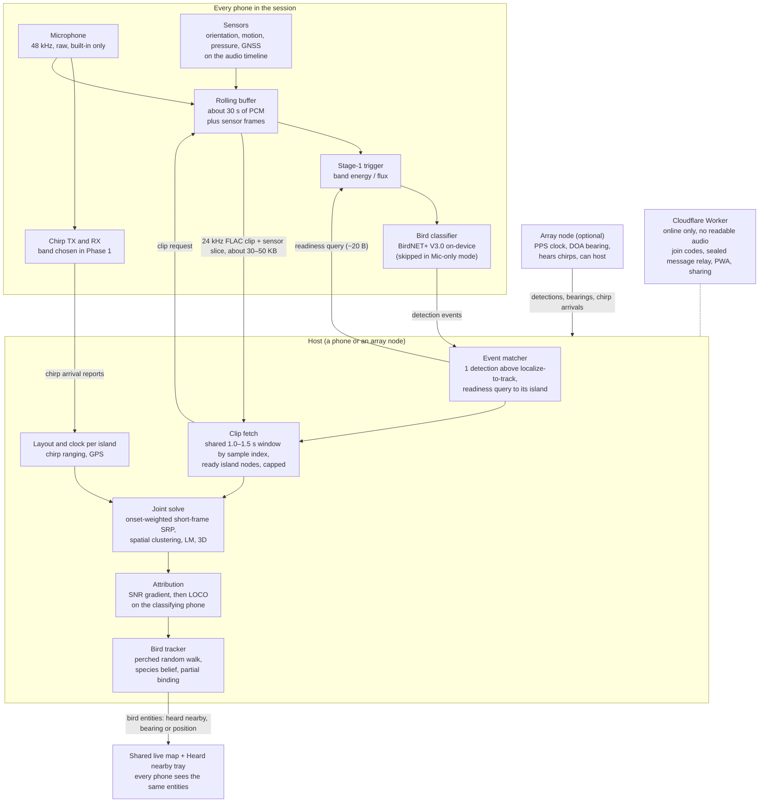

# MinimapPR Field Mode — Phone-Mesh Bird Localization Plan

## Summary

Core use case: a group of birders (say 6 people) go into the woods. Most likely they still have cell service. The group is spread out a bit (likely in several clumps, often 2 or 3 people together). Together they connect their phones and get localized bird detections to help them spot birds.

If just a single user is online, it won't be able to do localization, but it could still send notifications as they hike as it picks up birds. A common use case would be two users (a couple) hiking together. While not able to localize, it might still be nice if we could provide a bearing (ie it's north).

Another similar use case might be a group of security guards at a festival, using the localization for gunshot or drone localization.

All audio processing happens on the phones (and on any MinimapPR array node that joins); Cloudflare is our chosen cloud provider, and it handles only the minimal amount we need to (trying to keep to free tier or around $5/month for thousands of users). Local sessions (or hotspot sessions maybe) may never have to hit the cloud at all.

Given the phones are already connected, it might be useful to be able to send some sort of basic messages across the group as well (ie set a status or 'taking a break', 'heading home', 'request assistance' or something). However this would be a lower priority, secondary functionality.

Likely users will sometimes wander away into subclusters out of reach of the others. We might need some kind of "federation" or "islands" to account for this.

Setup would need to be clean and easy. Likely tapping on which models they want active (ie birds vs drone detection). We'd probably need to clearly show connections (ie if enough nodes are active close together enough for localization).

Aim to consume as minimal power as feasible (obviously running TDoA and quantized neural nets still is going to use a decent bit of power for any main server, but we should keep it as minimal as practical). One good way to do this is if the group is still on cell service, send everything back to an at-home plugged in MinimapPR server (say a laptop). But that might rack up high data usage if sending lots of audio back, and not everyone has unlimited data plans, so not all users will want to use that option.

Key decisions:

- **Native app on Android; a PWA on iOS until there is an Apple developer account.** Recording phones must keep recording with the screen locked and must run offline sessions, which only a native app does reliably. The interim iOS PWA may be somewhat limited in functionality given PWA limitations.
- **Every phone processes its own audio; one phone is enough to start a fix.** Each phone keeps a rolling raw-audio buffer and runs a cheap activity trigger; phones classify locally when the trigger fires (or not at all, in Mic-only mode). When any one phone's classification passes a low "localize-to-track" threshold, the host sends a tiny readiness query to every other synced phone in the same acoustic island (in sync, no speech, no handling noise; in-band level is reported for ranking) and pulls one shared 1.0–1.5 s lossless clip of the active window from each one that passes, up to a configurable cap. A phone's Stage-1 trigger does not have to have fired: a bird 35 m away can sit below the trigger and still give a clean GCC-PHAT peak, so faint birds that only one phone can name still get localized.
- **Species belongs to the track, not to one bout.** A bird's first bout may give a clean fix and a weak ID, its second a strong ID and a noisy fix. Neither bout has to pass both alone: each spatial track builds up a species belief across bouts, and a bout that fails to localize can still bind to an existing track through a partial spatial constraint. The display threshold applies to the track's belief, not to a single classification (see Track-level species fusion).
- **One bird is one entity on screen.** Unlocalized, bearing-only and pinpointed detections of the same bird are states of one entity, not separate events. Unlocalized species sit in a "Heard nearby" tray, never as map pins, and move onto the map when a later bout localizes them (see Field UX).
- **Proven on the server first.** The detection-to-localization fixes (onset-weighted short-frame SRP with spatial clustering, the perched-bird tracker with species belief, occlusion attribution, the entity model) need no phones or chirps. A server track built alongside Phase 1 proves them on today's MinimapPR replay bundles, and fixes the same two problems on the server, before Phase 2 ports them into `minimappr-core` (see Server track).
- **Groups split into acoustic islands, not federated hosts.** When clumps drift out of chirp range of each other but stay connected, one host keeps a separate layout, clock domain and chirp schedule for each island, and the islands merge again as soon as any phone hears another island's chirp. Offline, a phone that loses the host drops to solo detection and uploads what it heard when it reconnects. There is no automatic sub-host election (see Group splits and acoustic islands).
- **Sound and GPS set geometry and timing.** Phones chirp to each other at high frequency, which gives centimetre distances and sample-level clock offsets. The chirp band is picked in Phase 1 from bands starting at about 13 kHz, favouring what birds can't hear over what people can't hear; a low-pass filter below that floor keeps other phones' chirps out of detection, so the group never goes deaf during a round. Phone localization (GPS) may only be accurate enough to place the whole layout on the map. The chirp schedule is a setup choice: "silent until needed" (the default: rounds only when the group stops and right after detections) or a periodic baseline. Users can also turn chirps off (detections only) or force the highest band.
- **One timebase, and the platform's own sensor fusion.** On each phone, audio, motion sensors and GPS all sit on one monotonic OS clock (Android `CLOCK_BOOTTIME`, iOS host time), never the wall clock. Orientation, steps and pressure come from the platform's fused sensor APIs rather than our own filters. Onboard multi-mic capture is used only where the OS confirms raw channels and the mic positions are known; users never enter measurements.
- **Mixed node types from the start.** Phones and MinimapPR array nodes (tetrahedral, XVF3800) share one node descriptor and one solver that combines time-difference (TDOA) and direction (DOA) measurements. A portable array node can also anchor the mesh to UTC and host the session.
- **One shared Rust core.** Localization, sync and fusion code is shared with the MinimapPR Linux server through a mobile-safe Rust crate, wrapped for Android (and later iOS) through UniFFI and compiled to WASM for the iOS PWA.
- **Transport is a setup choice, defaulting to "auto by signal".** Session setup offers Solo (no connection at all), Auto, Local only and Online only. With cell signal, Auto relays every session message through the session's Cloudflare Durable Object over a WebSocket. That works behind any carrier NAT and from Safari, and needs no WebRTC, STUN or TURN. Messages are sealed end to end with a key carried in the QR code, so Cloudflare never sees audio. Direct WebRTC data channels (str0m) stay on file as a later cost optimisation, built only if relay usage calls for it. With no signal, Auto uses a local transport, started only when cell drops: an Android host's local-only hotspot or Google's Nearby Connections (Phase 2 spikes both and keeps the better one), or a portable array node's access point. Network.framework peer-to-peer (all-iPhone groups, native iOS, later) and Wi-Fi Aware (mixed groups, once proven) slot into the offline side. Online-first suits the core use case: groups that still have cell service, spread out in clumps further apart than a phone hotspot reaches.
- **Chirp sync is for quiet places at short spacing.** Phone-to-phone chirps work in quiet woods at roughly 5–30 m spacing. At a festival (85–100 dB SPL crowd and music, 50–150 m spacing), a phone speaker's chirp carries only a few metres. The security-guard use case therefore needs PPS-locked array nodes (which fit the same node descriptor) or opportunistic sync from loud ambient impulses, not phone chirps.
- **Design for Latest Firmware.** Target Android 16 and later. Older backwards compatability is nice to have, but not worth bringing in large complexity to handle. iOS 26 and newer. We expect Pixel phones will be our main test case.

The largest technical risk is sound-based clock sync on stock phones. Phase 1 tests it with two Android phones (plus one iPhone in Safari) before anything else is built. The second risk is the iOS PWA reaching a host from a browser; the plan limits it to the online relay (a secure WebSocket to Cloudflare, which any browser can open) and a Linux host's HTTPS, and offline iPhones without a Linux host run solo, detection-only.

## Requirements and non-goals

The target is "which tree" accuracy (about 1–3 m) for birds 5–50 m away, with 3–8 phones, fully offline.

| Requirement | Target | Why |
| --- | --- | --- |
| Localization accuracy | 1–3 m horizontal inside the phone layout; bearing-quality outside it | Enough to point at a tree; see the error budget below |
| Group size | 3 phones minimum, 4 recommended, up to about 8; or 1 array node + 2 phones | 3 is the 2D minimum; 4 adds a check and outlier rejection; an array node's bearing replaces phones |
| Inter-phone clock sync | Better than 100 µs (sample-level, about 21 µs at 48 kHz) | 1 ms sync already costs about 0.7 m |
| Relative phone geometry | About 10 cm, refreshed whenever the group stops and right after detections (and every 5–30 s on the periodic schedule) | Phones move as people walk |
| Connectivity | Works with no internet or cell signal; uses cell signal when present so clumps further apart than a hotspot reaches stay in one session | Woods; groups spread out in clumps |
| Platforms | Android native; iOS as a foreground PWA first, native iOS later; mixed groups | Real birding groups are mixed; no Apple developer account yet |
| Audio leaving the phone | Only short, lossless active-window clips (1.0–1.5 s, about 30–50 KB) to the host, inside the session, plus a 2–3 s playback window when someone taps a bird; clips dominated by speech are not sent | Privacy and bandwidth; no readable cloud audio |
| Cloud | Cloudflare Workers for join codes, model downloads, PWA hosting and post-session sharing; a Durable Object relays online session messages over WebSocket, sealed end to end so Cloudflare never sees audio | Cheap, small transactions only; target free tier or about $5/month |
| Battery | At least 3 h of session on a typical phone; host may need a power bank | Morning walk; two-stage triggering keeps the classifier idle most of the time |
| Detection band | Full bird band, 48 kHz capture, no OS voice processing, built-in mic pinned | Many songbirds sit at 3–8 kHz; Bluetooth headsets drop input to 8–16 kHz |

**Error budget.** Path-length error per phone pair. These are estimates, to be replaced by Phase 1 and Phase 3 measurements.

| Source | Size | Note |
| --- | --- | --- |
| Clock sync residual | 50 µs, about 2 cm | Phase 1 gate |
| Mic-path delay, chirp band against bird band | Unknown; likely under 100 µs (3 cm) | Per model; Phase 1 clap test at 2–8 kHz |
| Chirp-ranged geometry | About 10 cm | At the moment of the round |
| Phone moved since the last round (in a hand, binoculars raised) | 10–40 cm | No steps involved, so only motion data sees it |
| Sound bending round the carrier's body | 10–25 cm | When the bird is behind the person |
| Reflections shifting the correlation peak | 5–30 cm | Onset weighting and SRP reduce it |
| Speed of sound, 1 °C error | Up to about 3 cm | 0.18% of the path difference |
| Steady wind | Cancels to first order | See below |

Clock sync is not the limit; where the phone is, and what stands between it and the bird, is. About 30 cm per pair across a 15 m layout is roughly 1° of bearing, or under 1 m sideways at 40 m, which still meets the target. Two things follow:

- Sync effort beyond the Phase 1 gate buys little.
- Each phone's position uncertainty in the solver grows with its motion energy since the last chirp round, not only with walking time, so a phone lying on a log outweighs one in a moving hand. This uses motion data the phone already collects. In hand, in pocket and set-down are all expected in real use, and the placement flag (see Phone sensors and timebase) is not reliable enough to gate or re-weight audio, so it stays advisory: prompts and chirp slots only.

A steady wind makes the two directions of a chirp exchange take different times (about 170 µs per m/s over 20 m), which shifts the measured clock offset. The same wind shifts a bird's arrival-time difference between those two phones by the same amount, so the two cancel and no correction is applied. Outdoor offset residuals will still wander with gusts, so the Phase 1 offset gate is measured at short range.

Non-goals for the first release:

- Long-range (beyond about 100 m) or kilometre-scale localization; that stays with fixed MinimapPR nodes.
- Phone-chirp sync in loud venues or at spacing beyond about 40 m; those sessions need PPS-locked array nodes.
- Recording or archiving audio beyond the rolling buffer, except clips the user saves on purpose and each localized bird's 2–3 s classification window, which stays on the phone that classified it until the session ends (for tap-to-hear).
- Automatic offline federation (electing a sub-host, a second hotspot, merging diverged logs). Offline splits fall back to solo detection or a manual sub-group.
- iPhone hosting of any session before native iOS exists; iPhone hosting of mixed groups before Wi-Fi Aware interop is proven.
- A PWA that records in the background or with the screen locked. The interim iOS PWA records only in the foreground with the screen on.
- Cloud processing of any kind.

## System architecture

Every phone is a node; one device is also the host, either a phone or a portable array node. Phones keep raw audio to themselves and send only small messages, until the host asks for short clips of a call that one phone classified and others heard.



Each phone sends detection events and chirp reports. When any node makes a detection above the localize-to-track threshold, the host sends the other synced nodes in the same acoustic island a tiny readiness query ("are you in sync, and is your audio around $t$ free of speech and handling noise, and what is your level in $[f_{\min}, f_{\max}]$?"). It fetches one shared active-window clip from the classifying node and every node that answers yes, up to a cap, solves the position and pushes it to every map. At least three nodes with clips (or an array node plus two) are still needed for a 2D fix; fewer gives a detection, or a bearing where the geometry allows.

**Roles.**

- **Node (every phone):** capture, rolling buffer, Stage-1 trigger, on-device classification (unless in Mic-only mode), answering readiness queries, chirp send and receive, local map display. A phone that classifies a bird that then gets localized keeps its 2–3 s classification window until the session ends, for tap-to-hear.
- **Mic-only node:** a phone (low battery, or the interim iOS PWA when inference is too slow) that runs no ML, only capture, Stage-1 and chirps. It takes full part in localization. The host can also round-robin classification among phones in the same chirp-ranged clump (within a few metres), so a tight clump of three classifies each call once, not three times. A phone whose OS reports low thermal headroom moves itself to Mic-only and slows its map redraws before the OS throttles its capture thread. Its heartbeat carries that headroom, so the host can rebalance the round-robin (see [Thermal headroom](field_mode_phone_sensors.md#thermal-headroom)).
- **Array node (optional, MinimapPR tetrahedral or XVF3800):** PPS-locked capture, per-call DOA bearing, passive chirp listening, and, for a Linux/Pi backpack node, the Wi-Fi access point and host role.
- **Host (an Android phone with a power bank, or a portable array node):** runs the transport, tracks which phones form each acoustic island, schedules chirps and keeps the layout and clock models per island, matches events, fetches clips, solves positions, runs the tracker, and keeps the session event log.

**Load.**

- **Clip format.** Each clip covers one shared active window of 1.0–1.5 s around the trigger, plus a margin for the largest inter-node delay, and serves every species active in it. It is not one clip per species. A tight 0.3–0.6 s syllable clip per species was the earlier design. It made the phone guess which syllable belonged to which species from a coarse spectrogram, and it gave the host one chance per bird to catch a clean note. In a flock or a dawn chorus that guess fails: a louder bird in the same band takes the window, or two birds blend into one correlation. A shared window gives the host several notes from every bird active in it, and the solver sorts them out spatially (see Localization solver). The phone decimates it to 24 kHz with an exact linear-phase FIR (about 10.5 kHz passband, stopband from 12.5 kHz, below the chirp floor so strong chirps cannot alias into the 8–12 kHz upper bird band; in drone and gunshot mode the filter must also leave sub-100 Hz energy intact) and compresses it with lossless FLAC. That is about 30–50 KB per phone per trigger, against 96–192 KB for ±1 s of raw 48 kHz PCM16. Timing survives to the sample, and playback and host re-classification still work. Expect FLAC itself to give only about 1.5–2× on noisy outdoor audio; most of the saving comes from the window and the decimation. Two costs come with the longer window. In-clip clock-rate correction becomes mandatory (50 ppm across 1.5 s is 75 µs). And more speech can get in, so the VAD mask (see Classification) matters more.
- A busy dawn chorus at one trigger per second with 6 phones is roughly 250 KB/s at the host: fine on WiFi or cell. It is less than one syllable clip per species would cost once three or more species share a window, because the host does not re-trigger while an already-pulled window covers the time. Even 1,000 triggers in a hike is about 40 MB of cellular upload per phone (the host downloads several times that), which still makes "offload to an at-home MinimapPR server" realistic for users on limited plans.
- Six phones make 15 pairs. Band-limited GCC-PHAT on 10–20 short onset frames per clip, a coarse-to-fine SRP grid per frame, clustering and LM refine should take about 100–200 ms per clip on a recent phone; Phase 2 measures it (see Localization solver).
- When calls arrive faster than the host can process, it drops the oldest pending call and counts the drop (the backpressure pattern from the audio app and MinimapPR's classification queue).
- Classification runs on the phones, not the host, so the host does no more inference than any other node, and round-robin within clumps keeps the group's total inference near one run per call.
- Tap-to-hear windows (2–3 s, about 50–100 KB as FLAC) move only when someone taps a bird, so they add little to the load.
- Offloading the host role to an at-home MinimapPR server saves less phone battery than it might seem. Classification already runs on the phones and a solve takes under 100 ms, so the saving is mostly message fan-out and clip downloads. Its real value is hands-free hosting and a live archive at home.

## Acoustic self-survey and clock sync

Phones measure their distances and clock offsets by chirping to each other; GPS only anchors the result on the map. Phone OS audio timestamps are unreliable (input latency jitter, callbacks up to about 100 ms late), so every timing measurement is a sample count on the phone's own audio clock. A coarse mapping from sample count to the OS clock (the clock anchor, see Phone sensors and timebase) places events within milliseconds for matching and clip requests, but never enters a TDOA.

**Two-way ranging.** Phone A chirps, then phone B. Each phone records both chirps and counts the samples between them on its own clock. The BeepBeep form includes each phone's own speaker-to-mic distance, $d_{AA}$ and $d_{BB}$:

```math
d_{AB} = \frac{c}{2}\left[(t_{A,2} - t_{A,1}) - (t_{B,2} - t_{B,1})\right] + \frac{d_{AA} + d_{BB}}{2}
```

Leaving that term out biases every distance by half the summed speaker-to-mic distances. The distance depends on which speaker and mic the phone uses (a bottom speaker sits 1–2 cm from the bottom mic; the earpiece is 12–15 cm away), so the app keeps a per-model $d_{ii}$ table, which we calibrate once per model against a tape-measured 1 m pair (users never do this).

The same two arrival pairs also give the clock offset between A and B, since the two flight times are equal. The offset and the distance come from one exchange, the same way UWB two-way ranging works.

**Rate compensation inside the exchange.** The formula assumes both phones count the turnaround interval at the same rate, but it subtracts two large intervals measured on different crystals. In a 6-phone round, the gap between phone 1's and phone 6's chirps is 1.2–2 s; at 50 ppm relative drift, 2 s is a 100 µs error, which alone would fail the Phase 1 50 µs gate (and biases distance by about 1.7 cm). So before solving, scale B's interval by the tracked clock-rate ratio, $(t_{B,2} - t_{B,1}) \cdot (1+\alpha_A)/(1+\alpha_B)$, using rates estimated from consecutive rounds. Alternatively, use symmetric double-sided two-way ranging: the first phone chirps again at the end of the round, so the rate falls out of the same round. Phase 1 implements both and keeps whichever has the lower residual.

**Chirp design.**

- **Band, chosen in Phase 1 for birds first.** The Phase 1 harness sweeps 18–20 kHz, 15–18 kHz and 13–16 kHz. 18–20 kHz loses the most: air absorbs about 0.4–0.6 dB/m (roughly 10–15 dB over 30 m), phone speakers beam narrowly at a 1.7 cm wavelength, and many OEM audio paths roll off above 16–18 kHz even in `UNPROCESSED` mode. Published phone ranging at these frequencies mostly tops out at 5–25 m indoors. Most songbirds hear poorly above about 8–10 kHz, so 13–16 kHz is preferred when it ranges clearly further, even though people under about 40 will hear a faint tick. The floor sits at about 13 kHz rather than 12 kHz so that the detection low-pass (stopband from 12.5 kHz) removes every chirp; that costs a little range in the lowest band and leaves the classifier nothing above about 11 kHz, which very few birds need. Audible 2–6 kHz chirps are the last resort because birds hear them.
- **One speaker only.** Modern phones play `USAGE_MEDIA` from the bottom loudspeaker and the earpiece together, about 15 cm apart. A mono chirp then leaves as two copies up to about 440 µs apart, which comb-filters the chirp band, gives receivers a double arrival and spoils the self-recording $d_{ii}$. The app plays a stereo buffer with the chirp on one channel only, the one that maps to the bottom speaker. Phase 1 finds that channel per model and checks whether Android swaps left and right when the screen rotates; the same check runs on iOS.
- **Long and quiet, not short and loud.** A phone's own mic sits about 1 cm from its speaker, so a full-scale burst can clip the self-recording or trip a hardware limiter or AGC, which distorts the $t_{A,1}$ peak. Use longer chirps at lower level (more time-bandwidth product gives the same matched-filter gain), and measure self-recording headroom per model in Phase 1. A phone with verified stereo capture (see Onboard multi-mic) records its own chirp on the mic farthest from the speaker: 12–15 cm away it hears the chirp roughly 15–20 dB quieter, so the chirp level can stay higher. $d_{ii}$ is then the distance to that mic.
- **Doppler-tolerant waveform.** A linear FM sweep turns a Doppler shift into a timing error: about 70 Hz at 20 kHz for 1.2 m/s of relative motion, which shifts the peak by several milliseconds for a 100 ms, 2 kHz sweep. Phase 1 compares linear FM against hyperbolic FM (Doppler-invariant), with a per-phone code so overlapping arrivals can be told apart. Codes are seeded by the session ID, so two groups meeting on a trail do not share them.
- **First arrival, not strongest peak**, because reflections can be stronger than the direct path.
- **Watch for sound through the phone body on the self-chirp.** Sound crosses a phone's glass and aluminium frame at about 5,000 m/s (about 30 µs over 15 cm), against about 440 µs through air. A raw first-arrival threshold on the self-recording, especially on the far mic, can lock onto that structural precursor, and the precursor changes with how the phone is held: in a hand, on a rock, or on foam. Phase 1 measures the self-recording impulse response on foam, in a tight grip and on a hard wooden table, and compares a matched-filter onset against a raw threshold. It also checks whether the near mic (where the air and body arrivals are under 50 µs apart and air dominates) is more stable despite its lower headroom.
- **Speed of sound from air temperature.** Phones have no air-temperature sensor (battery and skin thermistors read 5–15 °C hot while audio and inference run). So the temperature comes from weather fetched at session start, corrected for the climb since then from the barometer (about −6.5 °C per 1,000 m), and the solver may refine an effective speed of sound inside a tight bound. Offline with no weather, a seasonal default gets a wider bound (see [Air temperature](field_mode_phone_sensors.md#air-temperature)). 1 °C error is about 0.18% distance error.
- **Chirps are filtered out of detection, not blanked.** At 13 kHz and up the chirps fall inside the 48 kHz capture band but above the detection low-pass that feeds Stage 1, the classifier and the 24 kHz clip decimation, so other phones' chirps never reach detection and nothing has to be blanked for the whole round. Each phone softly blanks only its own transmit slot (about 50–100 ms), where clipping and intermodulation 1 cm from the speaker could spill below 10 kHz. Blanked audio is faded and filled with noise at the running noise floor, never zeros: hard zeros make broadband clicks in the classifier's spectrogram, and BirdNET+ V3.0 returns NaN on zero-variance input. Phase 1 measures how much a nearby phone's chirp leaks below 11 kHz at 1–2 m; if it does, those slots get blanked on the receivers too.

**Schedule.** The host assigns chirp slots round-robin, one phone per slot. Phones do not chirp at the same time even with orthogonal codes: a phone's own speaker 1 cm from its mic drowns a distant phone's chirp (the near-far problem). A slot needs about 100 ms of flight time at 35 m, a chirp of about 50 ms and a 50 ms reverberation tail, so slots of 0.20–0.25 s bring a 6-phone round to about 1.2–1.5 s. Short slots matter because phones also move without taking steps (see below).

Session setup offers two schedules:

- **Silent until needed (default).** A round runs immediately when the phones' accelerometers show the group has stopped walking (birders stop when they hear a bird), and once right after each detection. A slow heartbeat round (every 60–120 s) keeps drift tracked, notices pocketed phones and finds islands that have come back into earshot. This cuts chirps by roughly 80–90% against a periodic schedule. The cost is that the first fix after a long walk arrives a few seconds late. The host localizes at once with the current model and refines the position when the post-detection round lands. Two rules govern that refinement:
  - **Rate comes from the heartbeats, not from a second quick round.** Two rounds 3 s apart, each with about 20 µs of noise, give a rate only to about $\sqrt{2} \cdot 20\,\mu\text{s} / 3\,\text{s} \approx 9$ ppm, and extrapolating that back 4–5 s adds error. Crystal rate changes slowly (thermal time constants of minutes), so the single post-detection round is fused into a per-phone clock filter that already carries the rate from the heartbeats. A second close round runs only for a phone that has no valid rate (a new joiner, or one that just had an audio gap).
  - **Clock goes backward; geometry only if nobody moved.** The clock model is offset plus rate, so the post-detection offset applies backward to the call's buffered audio whenever the phone had no sample gap in between. Geometry is different: birders walking when the bird sings, who stop and raise binoculars before the round, have each moved 1–3 m. The host checks each phone's sensor frames between the call and the round, and applies the post-detection layout backward only to phones that were already still at the call. Phones that moved keep the last layout from before the call with their position uncertainty widened by how long they walked, and are down-weighted as walking phones are in a round.
- **Periodic baseline.** Rounds every 5–30 s, plus the stillness and post-detection rounds. More chirps, but positions are fresh the moment a bird calls.

Users can also turn chirps off (detections only, unless an array node provides sync) or force the highest band.

During a round, phones whose accelerometers show walking are down-weighted or skipped. What matters is relative motion between phones: a group walking together moves much less relative to each other than the 1.7 m each person covers in a 1.4 s round, but it is still enough to break the rigid-layout assumption.

Motion without steps matters too. A still birder still turns, raises binoculars or shifts their stance, and the step detector sees none of it. Moving a phone 15 cm between phone 1's slot and phone 6's slot changes a flight time by 440 µs, which puts a 220 µs error into the two-way clock offset, four times the 50 µs gate. Besides short slots, the clock-offset graph weights each pairwise constraint $(i, j)$ inversely by the time between the two slots $\lvert t_i - t_j \rvert$ and by the linear-acceleration energy in that interval, so adjacent, quiet slots carry the clock sync.

**Clock model.** Each round updates a per-phone clock model (offset plus rate, since crystals drift tens of ppm) in a small filter whose rate changes slowly between heartbeats. Any gap in a phone's sample stream, or any audio route change or session interruption, invalidates its model until the next round. A Phase 5 experiment feeds high-SNR localized bird calls heard by 5 or more phones back into the factor graph as extra clock constraints, tracking drift passively between chirp rounds (as in El Badawy et al. 2023 and Wang et al. 2024). That matters most under the silent-until-needed schedule.

**Clock-rate correction inside each clip.** A rate offset stretches the clip as well as shifting its start: 50 ppm over a 2 s clip is 100 µs (about 4.8 samples at 48 kHz) from start to end, which smears the GCC-PHAT peak. Before correlation, the host resamples each clip to the reference clock using that phone's tracked rate (fractional resampling, or a linear phase correction in the STFT domain).

**Layout solve.** Pairwise distances feed a multidimensional-scaling initial guess, then a robust least-squares refine that rejects bad pairs. The result is a rigid layout in a local frame with per-phone uncertainty. It is mainly 2D, with relative phone heights from barometers (see Phone sensors and timebase) so sloped trails don't distort it. GPS altitude is often 15–30 m off and mixes ellipsoid and geoid heights across devices, so it is used only, with a wide uncertainty, for a phone with no barometer. An array node that hears the chirps but doesn't transmit enters the solve as a listen-only node (see Localization solver).

**Map anchoring.** The chirp layout is rigid to about 10 cm, so the whole group has only three map unknowns: east, north and rotation. Fit the layout to every phone's GPS fix at once with a weighted robust fit (Umeyama/Kabsch with a Huber loss). Each fix is weighted by its reported accuracy, inflated by its GNSS quality score (see Phone sensors and timebase), because under trees the reported accuracy is often optimistic. Under canopy a fix may be 5–15 m off from trunk reflections. That error differs from phone to phone, so the robust fit rejects the one phone standing under a dense hemlock instead of averaging it in. The fit also gives the layout's rotation, so with 3 or more phones spread 15 m or more, phone compasses are optional.

**Mirror images.** Multidimensional scaling recovers a layout only up to rotation, translation and reflection, and a standard Umeyama/Kabsch fit allows only proper rotations ($\det R = +1$). If MDS hands over the mirrored layout, the fit silently distorts it and every localized bird comes out mirrored. So the fit runs on both the layout and its reflection and keeps the one with the lower Huber loss. It also tracks a chirality confidence, which is low when the layout is small next to GPS error under canopy. Any direction measurement locks the chirality at once: a stereo phone's or an array node's DOA of a chirp, or the group's walking track.

A slow filter then smooths the three anchor parameters over time. Multipath does not average out while the group stands still (trees and satellites barely move in 30 s). So when the step detectors and GNSS Doppler speed say everyone is still, the filter's process noise drops to near zero and a sudden GPS jump cannot drag the map. Fixes taken in clearings (strong signal, L5 lock) tighten the anchor, and the group coasts on them through dense woods.

A map anchoring error shifts every bird on the map equally; it does not blur positions relative to the phones. An array node with a surveyed position and orientation anchors the map directly. Two phones cannot get their rotation from GPS, because a 3–5 m baseline is far below GPS error; see Couples under Localization solver.

**What can break it.**

- Chirps from the wrong speaker. On iOS Safari, opening `getUserMedia` often moves Web Audio output to the quiet earpiece, and may apply voice processing despite `echoCancellation: false`. Phase 1 logs Safari's chirp level at a receiving phone; if it is too weak, the iOS PWA listens to chirps but does not send them, or runs detection-only. A listen-only phone has both its position and its clock offset unknown, so it needs at least three chirping phones in earshot (four for any redundancy) before it can join a fix.
- Phones in pockets block high-frequency chirps. The app shows a per-phone "hearing quality" score and a "set your phone down" prompt. The prompt asks for the phone screen-up on a log, rock or pack with the mic ports clear. A mic within about 1 cm of a hard surface gets direct and reflected sound in phase, up to about 6 dB louder, with no ground-bounce notches. While walking, a chest strap or shoulder-strap clip beats a pocket by a wide margin above 4 kHz. Placement is detected directly, not inferred from missed rounds. On Android, the proximity sensor reading "near" with ambient light under about 5 lux flags a pocket or pack at once. The host then skips that phone's chirp slot and shows the prompt. The phone stays in readiness queries, where its measured in-band SNR decides whether its clip helps. A phone lying still and flat is marked as resting on a surface, which selects its rigid-surface self-chirp profile (see [Placement](field_mode_phone_sensors.md#placement)). A phone that misses rounds falls back to detection-only mode (no position).
- Muted media volume. Birders routinely mute their phones in the woods, and chirps on `USAGE_MEDIA` then silently vanish (Android 17 also blocks background volume changes, so the app cannot fix it itself). Each phone checks its own chirp's amplitude in its self-recording on its first slot; if it is low or missing, the app shows a banner ("Media volume muted, turn it up to enable sync").
- Loud places and wide spacing. Above roughly 40 m spacing, or in crowd and music noise, phone chirps will not range at all (see Summary). Those sessions rely on array nodes.
- Audio route changes. Bluetooth earbuds, a smartwatch or a phone call can silently switch input to an 8/16 kHz Bluetooth HFP mic or interrupt the audio session. The app pins the built-in mic (`AudioRecord.setPreferredDevice` on Android, `AVAudioSession.setPreferredInput` on native iOS). It treats any input route change, any change to the chirp output route, and any interruption as a hard clock-model invalidation, and shows it to the user. Output-only changes do not invalidate the clock, but they hide a trap: connecting Bluetooth earbuds moves media audio, chirps included, to the earbuds. On Android the chirp `AudioTrack` is therefore pinned to the built-in speaker (`setPreferredDevice` with `TYPE_BUILTIN_SPEAKER`), and its routed device is checked after every route callback. Whether native iOS can keep chirps on the speaker while Bluetooth headphones are connected is a Phase 4 test; until then, headphones make that phone a listen-only chirp node. The iOS PWA cannot pin input; it watches for `devicechange` and track `mute`/`ended` events instead.
- Another app taking the microphone. Birders will open Merlin Sound ID or a voice recorder mid-session. Android then gives the audio to one app and feeds the other zeros, with no gap in the sample count and no route change. The app registers an `AudioRecordingCallback` and checks `isClientSilenced()`. A silenced phone is marked deaf (no detections, readiness answers or clips) and its user is told; its clock model stays valid if Phase 1 confirms the sample count keeps running. On iOS another recording app interrupts the session, which is already a hard invalidation.

**Clap test (diagnostic and backup).** A sharp handclap is a 90+ dB SPL broadband impulse that carries 50–80 m, far beyond any phone speaker. A "Clap test" button has one person clap; the host checks that every phone's arrival time is consistent with the chirp layout and clock models. It verifies sync in the field, finds muffled or pocketed phones, and can give a one-off clock-offset fix when speakers are muted. It is used in Phase 1 and 3 testing as well as shipped as a diagnostic.

## Group splits and acoustic islands

Groups drift apart. "Federation" usually means several hosts, split-brain election and merging diverged logs, but most splits need none of that. Two cases are kept apart: clumps that are out of earshot of each other but still connected to one host (the common case), and phones that lose the network itself (offline only).

**Acoustic split while connected.** Six birders in one online session, or on a portable array node's access point, split into two clumps 60 m apart. Everyone can still reach the host; only the chirp graph has split. So the host does not keep one global layout and clock domain. It keeps the graph of which phones hear which (edges need valid SNR and two-way closure) and treats each connected component as an **acoustic island** with its own:

- reference clock and pairwise clock-offset and rate graph;
- rigid layout (MDS plus robust least-squares refine);
- map anchor: the rigid layout-to-GPS fit with 3 or more phones, the couple logic with 2 (see Couples), and a raw GPS dot with 1;
- stillness trigger and chirp scheduler. If one island stops for a warbler while the other keeps walking, the first runs its round at once. Islands out of earshot of each other may chirp at the same time; the per-phone codes tell apart the rare overlap as they come back into range.

TDOA pairs are formed only between nodes that share a clock domain: the same island, or two islands bridged by PPS-locked array nodes. Every island feeds its fixes, bearings and unlocalized detections into the host's single set of bird entities (see Field UX), never straight onto the map as separate events. When a call is heard in two islands, each island solves its own fix, and the tracker fuses them like any two fixes.

Islands merge again automatically. Per-phone chirp codes and the 60–120 s heartbeat rounds keep running, staggered across islands. The moment a phone in one island hears a chirp from the other with valid SNR and two-way closure, an edge reappears, the host joins the two clock graphs and layouts into one, and the session carries on with no handoff and no log merge.

The map shows the islands, which also answers "can we localize right now?" without explaining TDOA. Each island is drawn as its links or convex hull: green with 3 or more nodes (full fix), amber with 2 (bearing or couple), and a grey dot for a lone node (detection only).

**Network split while offline.** A subgroup that walks out of an offline host's Wi-Fi range (an Android local-only hotspot reaches only about 20–40 m in foliage) cannot reach the host at all. Automatic federation here would mean electing a sub-host, raising a second hotspot with new random credentials, moving orphaned phones onto it and later merging logs, which is fragile on Android and iOS. The plan degrades instead:

1. **Solo fallback and rejoin.** A phone that loses the host for more than a configurable 15–30 s drops to solo detection-only. It appends its detections, with GPS, to a local queue keyed by `(node_id, local_seq)` and keeps trying to reconnect. When it is back in Wi-Fi or cell range, it uploads the queue to the host's event log (the key makes the upload idempotent) and rejoins chirp sync.
2. **Manual sub-group.** A group that splits on purpose ("we'll take the other trail") taps "Start sub-group here", which starts a fresh local session and QR code for the people standing together. Afterwards, the two exported checklists can be merged.

Host handover (see Networking) is separate. It covers the host leaving, not phones losing it.

## Phone sensors and timebase

Each phone puts audio, motion sensors and GPS onto one monotonic OS clock (Android `CLOCK_BOOTTIME`, iOS host time), never the wall clock, and takes fused values from the platform APIs rather than building its own filters. API choices, onboard multi-mic details, and what was considered and not adopted are in [field_mode_phone_sensors.md](field_mode_phone_sensors.md).

- **Clock anchor.** Each phone fits OS time against its sample index over a sliding window. That places sensor frames on the audio timeline, flags dropped buffers, and gives the host coarse alignment for matching and clip requests. An unknown per-model audio pipeline delay (often 5–40 ms) keeps it out of TDOA, which stays with chirps.
- **Sensor frames.** A 25–50 Hz ring buffer (orientation, motion level, pressure, GNSS fix and quality) sits beside the PCM buffer, and every fetched clip carries its matching slice.
- **Orientation.** Android `TYPE_ROTATION_VECTOR` and `TYPE_GAME_ROTATION_VECTOR`, which work in a foreground service (Google's Fused Orientation Provider updates only in the foreground); `CMDeviceMotion` on iOS. With 3 or more phones the layout fit sets the group's rotation, so phone heading matters only for stereo phones and couples.
- **Motion.** The step detector and linear acceleration give the walking/still state for chirp rounds, the motion energy that weights clock constraints between slots, the check for movement between a call and the next round, and a handling score that blanks grip and footstep transients before Stage 1. Stage 1 is never switched off while walking.
- **Pressure.** Relative heights from barometers. A phone's offset is locked only when it is known to be next to another phone: at a QR join (the joiner stands next to the host), or when chirp ranging puts two phones under 2 m apart. Online late joiners using a short join code may be far away and higher or lower, so they wait for the second case. Barometers need 1–2 s to settle after the sensor starts.
- **GPS.** Android `GPS_PROVIDER` (independent fixes) feeds the anchor fit, weighted by a GNSS quality score (satellites used, C/N0, L5 lock). This is provisional; Phase 3 field data compare it with the fused provider.
- **GnssClock (Android).** A Phase 1 measurement: whether it can hold an audio clock rate across missed chirp rounds.
- **Power.** Sensor frames are batched in the sensor hub and flushed before each chirp round and clip. AAudio's overrun counter, if Phase 1 picks AAudio, is a third gap check.
- **Placement and heat.** Proximity and light flag a pocketed phone at once. Thermal headroom moves a hot phone to Mic-only, or a hot host to handover, before the OS throttles capture. Both ride the heartbeat (see [Placement](field_mode_phone_sensors.md#placement) and [Thermal headroom](field_mode_phone_sensors.md#thermal-headroom)).
- **No temperature sensor.** The speed of sound comes from weather and the barometer, not the phone (see [Air temperature](field_mode_phone_sensors.md#air-temperature)).

## Localization solver

The host turns a matched call into a position with one solver shared with the MinimapPR server. It is designed for forest conditions: tonal calls, strong reflections, several species singing at once, and birds 10–30 m up in the canopy.

**One phone classifies, every ready phone in its island contributes.** GCC-PHAT correlates cleanly at SNRs well below what a classifier needs for a confident species ID, thanks to the coherent time-bandwidth gain. A bird 10 m from one birder and 35 m from three others (15–20 dB quieter there) often gives only the near phone a confident hit, and can sit below the far phones' Stage-1 trigger, even though they hold perfectly usable signal for TDOA. So a fix waits neither for 3+ phones to name the species nor for their triggers to fire.

When any phone's detection passes the localize-to-track threshold, it reports the species it heard (top 3 with scores), the active window's time, and its active band $(t_{\text{start}}, t_{\text{end}}, f_{\min}, f_{\max})$. The host sends every other node in the same acoustic island a readiness query of about 20 bytes, answered from state each phone already keeps: in a synced island, the speech fraction from the VAD, any handling-transient flag, and the in-band SNR in the window. Sync, speech and handling are the only gates. In-band SNR is reported and ranks phones but never excludes one: a phone whose in-band level sits at its noise floor can still give a clean correlation peak (AGENTS.md: faint detections are not gated on level). Every node that passes sends its clip of the same shared 1.0–1.5 s window, up to a configurable cap (6–8 by default; when more pass, the host keeps the best in-band SNR and spread). One pull serves every species active in the window, so a second species' detection inside an already-pulled window adds no new clips.

- **Two thresholds.** Display and localization have separate thresholds. A detection above the low localize-to-track threshold (a starting point of BirdNET+ V3.0 score 0.15–0.25, and only when Stage 1 shows clear in-band activity) pulls clips and creates or updates a hidden, tentative track. Only a track whose species belief passes the display threshold appears to users (see Track-level species fusion). Low-confidence pulls run under a per-island clip budget (clips per minute) that the host enforces. When the budget runs out, the host keeps pulling for detections above the display threshold and counts the low-confidence pulls it skips. Both thresholds and the budget are config values, tuned on golden bundles against the clip-fetch rate.
- **Note onsets, not syllables.** BirdNET+ V3.0 scores whole 2–12 s windows; it gives no syllable times or frequency bounds, and two species can share one window. So Stage 1 keeps a finer spectrogram history: 32–48 sub-bands across 0.5–12 kHz at 20 ms hops, about 2.4 KB/s, or about 72 KB for 30 s. From it the phone marks discrete note onsets (peaks of positive spectral flux), answers readiness queries, and gives the host the active band. Onset times travel with the clip as a small list, so the host does not have to re-detect them.
- **Clip requests by sample index.** Once phones are chirp-synced, the host knows each phone's exact mapping to the island clock. It addresses each clip request by the target phone's local sample index, not by the coarse clock anchor, which removes the 5–40 ms pipeline-delay uncertainty. The clip margin then only needs to cover the island's diameter over the speed of sound (about 90 ms at 30 m), so notes are not cut off by accident.
- **Several species at once.** A dawn chorus has several species singing within the same second. The host no longer solves one species per clip. It localizes every note in the shared window, clusters the notes in space, and then assigns species labels to the clusters (see Attribution). Correlating notes of different birds produces confident nonsense, so a short onset frame is the unit of correlation, never the whole clip.
- **More than one phone classified.** Their detections merge into one event, and their per-phone scores are kept separately for attribution. Fusing them into one score, as the server's cross-node late fusion does, comes only after a cluster has its label.
- **False triggers.** A single false-positive detection costs one readiness query and a few clips. At the lower threshold this happens more often, which is what the clip budget bounds. A tentative track that never builds a species belief expires without ever being shown.

**Per-note localization with delay-compensated frames.** Many flock calls and warbler notes last only 40–150 ms. Running GCC-PHAT over a whole 0.5 s syllable mixes the direct sound, trunk reflections 3–25 ms late, and the next bird's note. Across a 30 m island the largest inter-phone delay is about 87 ms, so every phone can't be cut into the same 64 ms wall-clock frames either: a 50 ms note would fall outside the frame on a distant phone. So for each onset the host takes the reference phone's 60–100 ms window $[t_0, t_0 + L]$ and correlates it against $[t_0 - \tau_{\max}, t_0 + L + \tau_{\max}]$ on every other phone (an asymmetric template-against-search correlation, with the band-limited PHAT weighting below). SRP frames are weighted by positive spectral flux, so the onset, where the direct path leads the reflections, counts most. That suppresses multipath better than filtering peaks afterwards. It does not remove reflections: they start arriving within a few milliseconds, so only the first part of an onset is clean.

**Spatial clustering instead of a second peak on one map.** The earlier design summed a whole syllable into one SRP map and kept a second peak above a threshold. With 4–6 sparse phones, one map has strong sidelobes and multipath ghosts, so a fixed threshold routinely promotes an echo or sidelobe to a fake second bird, or blends two alternating birds into one smeared peak. Instead the solver scores the SRP grid on each onset frame in the clip, keeps each frame's peaks, and clusters them over the polar grid (weighted DBSCAN or a spatial histogram, weighted by each frame's onset strength and peak sharpness). Each cluster is a candidate bird that gets its own LM refinement and likelihood contour. A cluster is accepted as a second bird only when it passes the checks in the next paragraph.

**Telling a second bird from an echo or sidelobe.** Three invariants, cheapest first:

1. **Independent onsets.** Two birds in a flock rarely start at the same millisecond in the same band, so over 1–1.5 s each produces its own onset-led frames. An echo is time-locked 3–30 ms behind its source's onset in the same band and shows up mainly in decay frames. A cluster whose frames all trail another cluster's onsets by a reflection-sized lag is an echo.
2. **Per-phone level consistency.** Phones 15–30 m apart see large level differences from $1/r$ spreading; one compact array does not. For a candidate cluster, the phones nearest it must hold more in-band energy in its frames than the phones far from it, within a loose 6–8 dB margin for body shielding and pockets. A reflection of a bird near phone 1, or a correlation sidelobe, fails this. Phone mic sensitivity differs by several dB between models, so the host first normalizes each phone's level by its own running ambient noise floor, the diffuse background every phone hears about equally. The margin stays loose so it never rejects a faint, distant bird, and a cluster that fails only this check is held as tentative rather than deleted.
3. **Persistence across bouts.** Birds in a flock repeat from about the same perch for several seconds. A second cluster seen in only one window is shown as a second bird only if it passes both checks above, or if it reappears in a later note or bout.

On a single compact array (a server tetrahedral node, or a stereo phone) the level check does not apply. Independent onsets and persistence carry the decision there.

**Band-limited GCC-PHAT.** Full-band PHAT weights every frequency equally, which boosts wind below 1 kHz and insect and thermal noise above 10 kHz, and lets tonal whistles lock onto an adjacent period (cycle skipping). The solver limits PHAT weighting to each onset frame's active band $[f_{\min}, f_{\max}]$, taken from the active sub-bands of the 32–48-band history and narrowed by a spectral-energy mask on the clip itself. A species prior narrows it further only after a cluster has a label. This matches the server's measured finding that a wide PHAT band can reverse a bearing (see `project_localization_band_phat_ceiling`). Inside the band the weight is soft, not a rectangle: each bin is weighted by the lower of the two phones' estimated SNR in it, from the noise-floor trackers both already keep, so bins that hold only noise on the faint phone count less than bins that hold the call. A steady whistle (chickadee, titmouse, White-throated Sparrow) has almost no bandwidth, so its correlation is a comb of near-equal peaks one period apart (250 µs at 4 kHz) under a broad envelope. For frames whose effective bandwidth falls below a threshold, SRP sums the correlation envelope instead of its fine structure, and the reported uncertainty widens with the inverse bandwidth. Onsets and sweeps, where the call has them, still give the tight fix.

**Loop-consistency filter (argmax path only).** On the argmax-TDOA path, drop TDOA triples whose loop does not close, $\tau_{AB} + \tau_{BC} + \tau_{CA} \approx 0$ within the expected error. This rejects pair peaks that locked onto a reflection (as in CARDINAL). It does not remove pairs before SRP-PHAT: on a reflective pair the true direct path is often the second peak, and SRP recovers it by summing full curves. There the filter is only a diagnostic, and per-pair robust weighting (below) does the protecting.

**Distributed SRP-PHAT, then LM refine.** In heavy foliage, single pairs often have a stronger reflection peak than direct-path peak, so committing to each pair's argmax TDOA and then running Levenberg–Marquardt fails in exactly the cases that matter. Instead, the solver sums every pair's full GCC-PHAT curve over a spatial grid around the group, takes the global maximum, and refines it with LM. Only the 4-mic tetrahedral geometry in `src/srp_phat.rs` is phone-specific; the algorithm generalizes to any node layout.

- Polar grid, centred on the island's layout. A Cartesian box clips any bird beyond its edge onto the boundary (a 100 m box loses everything past 50 m from the centroid). Instead the grid uses 1–2 m cells inside about 30 m, log-spaced rings out to 150–200 m, and a far-field bearing ring beyond. That matches how TDOA range uncertainty grows with distance, hands distant birds over to bearing fans naturally, and depends less on how the layout is rotated.
- Cost: about 2,500 cells per height layer, the same as a 100 m box at 2 m spacing; with 8 height layers and 15 pairs that is about 300,000 table lookups into precomputed GCC arrays, a few milliseconds in Rust.
- Coarse-grid catch: a band-limited PHAT peak is only about 0.2 ms wide (about 6 cm of path difference), while a 2 m cell spans up to 2 m of path difference. At the coarse level, each cell takes the maximum of each pair's GCC over the TDOA interval the cell spans (or a smoothed envelope), then the grid is refined around the best cells.
- Robust per-pair weighting: each pair's contribution to a cell is clipped or Huber-weighted, so one pair dominated by a strong reflection cannot pull the maximum on its own.
- Two birds of the same species: spring woods are full of two males of one species countersinging, back to back or overlapping within a second. Species keying cannot separate them. Per-onset frames and spatial clustering can (see above), and each accepted cluster becomes its own position.
- Phase 3 compares SRP-then-LM against argmax-TDOA-then-LM on the same replay bundles and keeps whichever wins; the server's SRP-PHAT hardening item benefits either way.

**3D with a canopy-height prior.** A 2D solver that assumes the bird is on the ground squeezes canopy birds toward the array centroid and inflates residuals until valid overhead birds get rejected as outliers. The solver works in 3D with a soft prior on bird height above the local ground, $z \in [0, 35]$ m, and uses phone heights from the layout solve. A near-flat ground array sees height poorly and cannot tell above from below; the prior removes the below-ground mirror solution. The map shows the horizontal $(x, y)$ position with height marginalized out.

**Show the real uncertainty shape, not a Gaussian ellipse.** Outside the phone layout (a 15 m group and a bird 40 m away, which will be most detections, since chirp range favours tight layouts), the true TDOA posterior is a curved, elongated banana or wedge: a tight bearing and a wide range. A linearized LM covariance ellipse then looks overconfident or points the wrong way. The solver already computes the SRP score grid, so it marginalizes that 3D grid over $z$ and sends the top likelihood contour (for example the region holding 95% of the normalized score, after a temperature fitted on golden bundles so that the region really covers 95% of true positions; raw SRP power is not a probability) with each position. The map draws that contour, which naturally looks like a tight dot inside the layout and an honest wedge outside it. When the range spread exceeds a threshold, or the maximum lands on the far-field ring, the map draws a bearing fan from the group instead. The LM covariance is kept for the tracker and for uncertainty-calibration tests.

**Single-file trails (collinear layouts).** Birders on a narrow trail walk single file, not in a circle. A nearly collinear layout has no cross-trail aperture, so it cannot tell left of the trail from right, and cross-trail error is huge. The host computes the ratio of the layout's 2D eigenvalues (or the GDOP for the current bird estimate). When the group is nearly collinear, the solver reports both mirror candidates rather than picking one, uses a stereo phone's or an array node's DOA to break the tie when present, and the UI shows a gentle cue: "Line formation: one person step 3 m off the trail to resolve left and right."

**Joint TDOA + DOA over mixed nodes.** Every node in a session describes itself:

```text
NodeDescriptor {
  geometry:    SingleMic | SubArray { mic_offsets_m },
  orientation: Fixed | Surveyed | Imu | Unknown,
  clock:       Pps | Ntp | AcousticChirp | Unsynced,
  position:    Fixed | Surveyed | AcousticMesh | Gps,
  has_speaker: bool,
  ranging:     [Uwb | ChannelSounding | WifiRtt],   // radio ranging to other session devices, Phase 5
}
```

All measurements go into one weighted nonlinear least-squares objective (a small factor graph, after Wang et al. 2024):

- TDOA residuals between any two nodes that share a clock domain: phone–phone through chirp sync within one acoustic island, phone–array through the array hearing chirps, array–array through PPS (which can also bridge two islands);
- DOA residuals (azimuth, elevation) from any array node, weighted by its bearing covariance;
- TDOA residuals between the two mics of a stereo phone: a cone around its mic axis, rotated into the world frame by the phone's orientation at the time of the call;
- optionally an effective speed of sound as a free parameter (as CARDINAL does).

This is why one portable array node helps a phone group so much:

1. **Passive UTC and geometry anchor, no speaker needed.** A PPS-locked array node that hears two or more phones' chirps joins the layout solve as a listen-only node. That ties the phone mesh's clock to UTC, enables TDOA between the array and every phone, and, with a surveyed position and orientation, anchors the map frame. Its own DOA of each chirp also fixes the layout's rotation.
2. **Breaks the geometry minimum.** A 4-mic array gives a 3D bearing without any inter-node sync, so 1 array node + 2 phones already gives a strong 2D/3D fix.
3. **Wi-Fi access point and host.** A Linux/Pi node in a backpack can run the access point and the host role. That takes the hotspot and power-bank burden off birders' personal phones, and it can serve the iOS PWA over valid HTTPS offline (see Networking). It speaks the same `minimappr-core` message enum and MMB3 clip framing as a phone host.

**Phones with two raw mics (opportunistic).** A phone whose OS confirms two raw channels with known mic positions (see Onboard multi-mic) joins as a 2-mic `SubArray` with `Imu` orientation. Nothing else in the solver changes. What it can and cannot do:

- Top and bottom mics sit about 15 cm apart, so the largest delay is about 440 µs (21 samples). Outdoors, with hands and the phone body diffracting sound, expect roughly ±8–15° near broadside, and worse toward the mic axis.
- Above about 1.1 kHz (half-wavelength spacing), a pure tonal whistle has several equally good delays. Broadband calls, trills, sweeps, drones and gunshots resolve to one.
- Two mics measure a cone around the mic axis, not a compass bearing. Held upright, that axis points mostly up, and a bird 45° up shrinks the delay by 30%. The solver therefore always uses the cone in 3D with the phone's orientation, never a flat azimuth.
- On its own, the cone has a mirror ambiguity; another measurement has to break it.

**Couples.** Two chirp-synced phones give a sharp inter-phone cone around the line between them, but that cone has its own mirror ambiguity, and GPS can't give the line's heading at 3–5 m. If one phone has stereo capture:

- it measures the direction of its partner's chirps, which gives the heading of that line (the broadband chirp resolves the spatial aliasing);
- its own cone on the bird crosses the inter-phone cone at a different angle, which usually leaves one consistent bearing from a single call;
- repeated calls, or the phone turning (tracked by the gyro), remove what is left.

With two stereo phones, the crossing gives a coarse position. All of this falls out of the normal residuals, with no special mode.

Most couples will have two mono phones (every iPhone, and most Androids), and magnetometers are often 15–40° off in the field. Two fallbacks need neither stereo capture nor a compass:

- **Walking-track heading.** Over 15–20 m of walking, the GNSS track gives the direction of travel far better than a magnetometer. On a trail, walking partners are usually one behind the other, so the solver uses the track heading as a soft, wide prior on the inter-phone line's direction. Any measurement that disagrees (a stereo phone, a repeated call) overrides it.
- **Synthetic aperture over repeated calls.** Birds repeat themselves. If a bird sings twice while the couple has moved 8–10 m sideways to the line between them, or the line has turned (moving straight along the line leaves the cones on one axis and the ambiguity intact), the two inter-phone cones intersect, which removes the mirror ambiguity and, with enough movement, gives a coarse position. The tracker holds the earlier cone and matches the repeat by species and band.

With neither, a couple gets detections only, unless an array node joins.

**Attribution: which species belongs to which cluster.** A 1–1.5 s window can hold two clusters (A and B) and two species, say a loud robin and a quieter tanager, both at 2–5 kHz. The host has to label each cluster without swapping them, and without beamforming the audio before BirdNET (beamforming distorts what BirdNET was trained on). It uses a fast-to-slow cascade and stops at the first tier that settles the question with margin:

1. **Mesh SNR gradient (no extra inference).** Compare which phones heard each cluster's frames loudest against each phone's own BirdNET scores, or against band priors when only one phone classified. If phone 1 is nearest A and scored robin 0.90 and tanager 0.15, while phone 4 is nearest B and scored tanager 0.85 and robin 0.20, the labels are settled for free.
2. **Leave-one-cluster-out occlusion (LOCO).** Used when the clusters share a band and the gradient doesn't settle it, for example when both are near the same phone or the only receiver is a compact array. The solver already knows which onset frames and sub-bands belong to each cluster. The host sends those masks (a few hundred bytes) to the phone that classified the window, since only that phone holds the full 2–3 s classification window. The phone replaces cluster A's frames and bins with noise at its floor (the same noise fill as the V3.0 silence guard, never zeros) and reruns BirdNET, about 20–40 ms per rerun. The species whose score collapses (tanager 0.82 → 0.04 while robin stays at 0.88) belongs to A. BirdNET still sees a full-length natural spectrogram, close to its training data, not a beamformed stream or a 0.4 s snippet. Reruns are capped per window and counted.
3. **Closest-phone check (Phase 5 experiment).** Once a cluster is localized, the phone nearest it could run BirdNET on its own 2–3 s window, even if its trigger didn't fire. It is deferred: it adds inference on phones that would otherwise stay idle, and Phase 3 measures first how often tiers 1 and 2 leave a window unsettled.

When no tier settles the labels with margin, the clusters keep their positions with no species update, and the window still counts as one bout for each track's position.

**Track-level species fusion and partial binding.** Each spatial track keeps a running species belief (log-odds per species, fused across bouts, capped so one bout can't dominate), not a single label from one bout. Three bouts from one tree scoring 0.30, 0.45 and 0.40 together confirm the species at that spot. The display threshold applies to that belief. A bout that fails a full fix is not dropped and does not become a separate unlocalized event. Examples: only two phones passed readiness, multipath ruined the TDOA, or the group is a mono couple. The host first tries to bind it to an existing track from the last 20–30 s, using:

1. a matching species, or a match among the bout's top 3 candidates; and
2. whatever partial spatial constraint the bout has: a single two-phone hyperbola, a stereo-phone cone, an array-node bearing, or the per-phone SNR ranking across the island.

If it binds, the track's species belief and recency update, and its position gets a soft update from the partial constraint. A bird localized on its first bout with a weak ID and classified on its second with a weak fix then becomes localized *and* classified. If it doesn't bind, it becomes an unlocalized entity ("Heard nearby", see Field UX).

**Bird tracker: perched, not constant velocity.** A singing songbird sits still for 5–15 s between bouts, then may hop 10 m. A constant-velocity filter reads 1 m of fix jitter between bouts as velocity and coasts the bird away during the silence. The server already decays velocity toward zero on long coasts, but it still splits one intermittent bird into several tracks. In bird mode the tracker uses a zero-velocity (random-walk) process model. Position uncertainty grows with $\sqrt{\Delta t}$ during silence instead of drifting along a velocity. A relocation gate accepts a jump of 10–30 m as the same bird when the species belief matches and no other track of that species is nearer. Drone mode keeps the 6D constant-velocity filter. A two-mode IMM (perched plus relocating) stays a Phase 5 option, adopted only if field data show birds moving while they sing.

## Field UX

Birders have binoculars in their hands, so the app has to work without unlocking the phone to read a top-down map.

**One bird, one entity.** MinimapPR's server shows omni (unlocalized) and localized detections as separate events, and users find the mix confusing: the same bird appears twice, or as an unlocalized card next to its own map pin. Field Mode doesn't have two kinds of detection event in the UI. Every bird is one entity that moves through spatial states as evidence arrives:

```text
Heard nearby (unlocalized)  ──▶  Direction known (bearing fan)  ──▶  Pinpointed (contour or dot)
```

An entity steps back a state only when its track expires or its uncertainty grows past the state's limit, never just because one bout failed to localize. The entity model lives in `minimappr-core` and is built on the server first (see Server track), so the Leptos frontend, the PWA and MapLibre Native all render the same states.

- **Absorption, not duplicates.** When an unlocalized detection of species X arrives and an entity of X from the last 45–60 s already has a bearing or position, and the per-phone SNR profile fits it, the detection is absorbed. The pin pulses ("just sang"), and the entity's recency and species belief update; no new card or alert appears. A species is shown as Heard nearby only when it has no spatial entity, or when the per-phone SNR clearly places it in another part of the group. The window slides with each entity rather than using fixed time buckets, so a call that lands near a bucket edge cannot appear twice.
- **The map is spatial only.** It draws only likelihood contours, dots and bearing fans. An unlocalized detection is never pinned on a user's GPS dot, which people read as "the bird is right on top of Bob". Heard-nearby species live in a compact, collapsible tray at the edge of the screen. When a later bout gives a bearing or a fix, the species moves out of the tray onto the map as the same entity, with the same history.
- **Notification grace window.** In a synced group of 3 or more phones, a new species heard without an immediate fix holds its notification for 3–5 s, or until the post-detection chirp round and the first clip solve finish, whichever comes first. If a fix lands, one notification goes out: "Scarlet Tanager · 11 o'clock · 22 m". The "heard nearby" fallback goes out only if localization fails, or if the user has opted into unlocalized alerts. Solo sessions and couples without a bearing alert at once.
- **Lock-screen live card.** On Android 16 and later, the foreground service's persistent notification is promoted to a Live Update (`setRequestPromotedOngoing`, with `POST_PROMOTED_NOTIFICATIONS`): one always-expanded card on the lock screen plus a status-bar chip, updated in place. It shows the island state ("4 synced", green) and the latest entity ("Scarlet Tanager · 11 o'clock · 22 m · high canopy"), so a birder can glance at it without unlocking. It is the main eyes-free surface. Separate notifications go out only for a new species (after the grace window) or a user-starred target, so a dawn chorus updates one card instead of piling up alerts. Native iOS gets the same card as a Live Activity in Phase 4; the PWA keeps its on-screen view. Phase 3 confirms that a birding session meets Google's criteria for promoted notifications.
- **Eyes-free cues.** The live card and each notification carry an egocentric cue built from the bird's 3D position and the phone's orientation: "Scarlet Tanager · 11 o'clock · 22 m · high canopy". Notifications mirror to Wear OS, Apple Watch and Garmin with no extra code. When the uncertainty region is a wedge rather than a dot, the cue gives the bearing and a range band ("11 o'clock · 20–40 m"). The user controls notification rate per species and silences repeats.
- **AR viewfinder (deferred).** Pointing the camera at the trees shows species pins and uncertainty wedges at each bird's estimated azimuth and elevation. It is a thin UI layer over positions and orientation the app already has, and faster than reading a map in dense woods. It follows the map and notifications.
- **Considered, not planned.** Three ideas are small but left until after the field beta. Silent haptic signatures (bird located, starred species, line formation). Head-tracked spatial audio cues through open-ear earbuds; on iOS these conflict with keeping chirps on the speaker. Pre-focusing the telephoto lens at the solved range in the AR view (Camera2 `LENS_FOCUS_DISTANCE`), so autofocus doesn't lock onto twigs.
- **Tap to hear.** A 1.0–1.5 s localization clip is right for TDOA but often too short, and too mixed with other birds, to recognize a bird by ear, and birders often tap a pin minutes later, after the 30 s rolling buffer has moved on. So for each localized bird, the phone that classified it keeps its own 2–3 s classification window until the session ends (capped in memory, oldest dropped first). Tapping a pin fetches that window from the phone, after the VAD check, and plays it with a spectrogram. If that phone has left, the host plays the best localization clip it already holds. Windows the user doesn't save are discarded with the session.
- **Who can localize.** The map draws each acoustic island's links: green with 3 or more nodes, amber with 2, grey for one (see Group splits and acoustic islands).
- **Individual counts, with honest uncertainty.** Merlin can say "Ovenbird heard 12 times"; spatial clustering of tracks can suggest "probably 3 Ovenbirds". Counting is hard, though. Birds sing in bouts with silent gaps and move between perches, so one bird that flew 30 m between bouts looks like two, and two birds alternating from nearby perches can look like one. The app therefore shows a minimum count: individuals heard at the same time from clearly separate places. It shows a likely range only when the clusters are well separated in space and stay separate over time, labels both as estimates, and lets the user merge or split clusters by hand. A track that falls silent and a new one that starts close by are merged by default; the perched-bird tracker's relocation gate makes that the normal case rather than a UI patch. Tentative (hidden) tracks never count.
- **Checklist export.** Post-session sharing exports an eBird-style checklist with distance bins from the group (point-count style), using the minimum counts unless the user edits them.

## Networking and session model

The host's event log is the source of truth, as in pcplayerpicker, where the coach device holds the full log and the server is optional. Which transport carries it is chosen at session setup:

- **Solo.** No connection at all. One phone gets detections and notifications; no localization. Nothing touches the network except optional model downloads.
- **Auto (default).** With cell signal, every phone and the host hold one secure WebSocket to the session's Cloudflare Durable Object, which relays messages between them (see Online relay). Nothing depends on how a carrier's NAT behaves. With no signal at session start, or when signal drops, the session runs on the local transports below.
  - While there is signal, the host does not also run a hotspot. A phone SoftAP draws about 300–500 mW continuously and complicates joiner routing.
  - When the host's cell link drops, or a joiner disconnects after reporting failing signal, the host starts the local transport. With the hotspot, it announces it over the BLE control service (native apps) and shows its QR code. Joiners in range get a "Tap to join local network" prompt: joining a particular Wi-Fi network from an app generally needs the user's approval, and the hotspot likely gets new credentials each time it starts. Nearby Connections does its own discovery and link setup, with no Wi-Fi join prompt. Phase 2 measures both on Android 16 and later.
  - Phones that don't join run solo and catch up when they reconnect (see Group splits and acoustic islands).
  - Over cell, idle heartbeats and GPS updates are batched (every 10–15 s while still) and flushed at once on detections and chirp rounds, so the modem can drop out of its high-power state.
- **Local only.** Hotspot, access point or peer-to-peer only; never uses cell data.
- **Online only.** The relay only; for groups that don't want anyone joining a no-internet Wi-Fi network (which can stall users' other apps, such as eBird, maps and messages).

**Online relay.** The Durable Object that hands out join codes also carries the session. Each phone and the host open one WebSocket to it, and it forwards messages by node ID; a host broadcast goes in once and fans out. It uses the WebSocket Hibernation API with no timers, so an idle session bills no duration. It is the baseline because it removes whole classes of risk: carrier-grade NAT and NAT64, ICE, TURN credentials and budgets, and Safari interop, since any secure page can open `wss://`. The extra 50–150 ms does not matter, because timing rides on sample indices, not on the network.

- **Sealing.** The QR code carries a session key that never reaches the Worker. Every message is sealed with an authenticated cipher under that key, so Cloudflare relays ciphertext only. A late joiner with a short join code gets the key from the host through a password-authenticated key exchange over the relay; the short code itself is never the key.
- **Ordering.** One WebSocket is one ordered stream, so a 40 KB clip on a weak link would hold up the detection events behind it. Clips are sent in chunks interleaved below control messages, and a clip more than a few seconds late is abandoned, not retried.
- **Cost.** Incoming WebSocket messages bill as requests at 20:1, outgoing messages are free, and an idle hibernatable object bills no duration ([pricing](https://developers.cloudflare.com/durable-objects/platform/pricing/), checked 2026-11-21; no data-transfer charge is listed). A 3 h session of an estimated 20,000–50,000 messages is about 1,000–3,000 billed requests. The $5 plan includes 1 million requests a month, which is several hundred sessions, and more cost $0.15 per million. The free plan allows 100,000 requests a day and fails beyond that instead of billing. The object enforces per-session message and byte caps; Phase 3 measures real usage.
- **WebRTC, later.** Direct data channels would take clips off Cloudflare altogether. If relay usage ever calls for them, the stack is [str0m](https://github.com/algesten/str0m) (pure-Rust, sans-IO) in the transport crate. Google's libwebrtc is ruled out: on Android it opens its audio device module and switches the phone into `MODE_IN_COMMUNICATION`, which can silently override `UNPROCESSED` capture. Direct paths should gather IPv6 candidates, since most carriers give handsets public IPv6. Phones behind carrier NAT would fall back to the relay, so Cloudflare TURN is not needed either way.

| Group | Transport | Status |
| --- | --- | --- |
| Has cell signal (Auto or Online only) | Sealed WebSocket relay through the session's Cloudflare Durable Object, for native apps and the PWA alike | Default when there is signal. Measure messages and bytes per session in Phase 3 |
| Includes an Android phone, no signal | Android host creates a local-only hotspot from the app (`LocalOnlyHotspot`), in Auto mode only once cell drops; others join over WiFi; a WebSocket server on the host carries messages | Proven APIs. Phone SoftAP range in foliage, with the OS picking 5 GHz and bodies shielding phones, can be only 20–40 m, too short for spread-out clumps. Test iOS joining it in Phase 2, not Phase 4: WPA3-only mismatches, 5 GHz channel quirks, and iOS dropping a no-internet network unless sockets are bound to it |
| All Android, no signal (candidate) | Google [Nearby Connections](https://developers.google.com/nearby/connections/overview) in star mode: Bluetooth discovery, automatic upgrade to a Wi-Fi link, no Wi-Fi join prompt | Phase 2 spike against the hotspot: range in foliage, join taps, reliability on Pixels, and whether it disturbs the phone's own Wi-Fi or cell data. Needs Play Services. Byte payloads are small (about 32 KB, to confirm), so clips go in chunks or as stream payloads |
| Portable array node present | Linux/Pi node runs a Wi-Fi access point (hostapd + dnsmasq) and the host role | Standard Linux; same protocol as a phone host |
| All iPhones (native iOS, later) | Network.framework with `includePeerToPeer = true` (`NWBrowser`, `NWListener`, `NWConnection`) over peer-to-peer Wi-Fi | Apple's recommended replacement for MultipeerConnectivity ([TN3213](https://developer.apple.com/news/site-updates/?id=07142026a), July 2026; forum reports say MultipeerConnectivity is deprecated in Xcode 27). TCP needs message framing; the binary message enum already provides it |
| iOS PWA node (interim) | Browser page served by Cloudflare (online) or by a Linux host over HTTPS (offline); talks to the host through the Durable Object relay (online) or a secure WebSocket to the Linux host (offline) | Online it uses the same message path as a native phone; see below |
| Mixed, no Android or Linux host | Wi-Fi Aware: Android has had it for years; [iOS 26 added it](https://9to5mac.com/2025/06/20/ios-26-to-let-third-party-apps-build-their-own-airdrop-alternative/) for iPhone 12 and later; needs native iOS | Cross-platform links unproven; [developer reports](https://developer.apple.com/forums/thread/790195?page=2) show negotiation failures (DCEA/encryption) |
| Discovery and control fallback | Bluetooth LE advertising plus a small GATT service (native apps only) | Works across platforms; too slow for audio clips |

**Getting the iOS PWA to the host.** Browsers give the microphone only to secure pages (HTTPS or localhost), and a secure page cannot open a plain `ws://` connection to a local IP. That leaves two routes:

- **Any host with cell signal:** the PWA loads from Cloudflare and opens the same relay WebSocket as a native phone. This is the common case.
- **Linux host (array node), offline:** the access point's DNS resolves a real hostname to the host, which serves the PWA and a secure WebSocket with a valid certificate renewed while online. This works fully offline.

QR-exchanged offline WebRTC is dropped. Safari replaces local host ICE candidates with random `.local` mDNS names, which often fail to resolve across an Android hotspot. QR exchange cannot trickle ICE, makes dense codes, and fails on reconnection or host handover. An iPhone with no signal and no Linux host runs a solo, detection-only session until native iOS exists.

**Session and join flow.**

1. The host taps "Start session" and picks the models (birds, drones and so on), the transport (Auto preselected) and the chirp schedule (Silent until needed preselected). Solo skips the rest of this flow. The app creates a session ID, a 128-bit join token and a host key, then shows a QR code holding the session ID, token, transport hint and (for the hotspot or access point) WiFi credentials, plus the PWA URL for iPhones.
2. Joiners scan the QR code. The app (or PWA) joins the hotspot or peer group, connects to the host and authenticates with the token.
3. If online, the host also registers the session with the Cloudflare Worker so late joiners can use a short join code instead of the QR code (they then get the session key by key exchange with the host; see Online relay).
4. The host assigns a node ID and chirp slot, and records the joiner's node descriptor; the joiner starts chirping and streaming detection events.

**Host handover.** The host keeps an append-only event log (detections, layout updates, localized birds) with monotonic sequence numbers, the same cursor pattern pcplayerpicker uses (`events?since=N`). Every phone mirrors it. If the host leaves, the next eligible device by join order takes over from its mirror and re-creates the transport. An iOS PWA is never eligible. On the hotspot path, everyone must rejoin the new hotspot, which the app does automatically. Handover covers the host leaving the session; a phone that loses contact with a host that is still running falls back to solo detection instead (see Group splits and acoustic islands). Low thermal headroom on the host also triggers a handover to a cooler phone before the OS throttles the host's audio or transport. That applies only on online transports, because a hotspot handover makes every phone rejoin a new network. On the hotspot path, a hot host sheds classification and map rendering instead.

**Cloudflare scope.** Patterns to take from pcplayerpicker's Worker (`server_cloudflare/src/lib.rs`):

- One Rust Worker deploy serving the static site, the iOS PWA and the small API.
- Separate tokens per role (host vs joiner vs view-only), carried in links and QR codes.
- D1 tables with cron TTL cleanup (sessions expire after 24 h).

What this app needs that pcplayerpicker lacks: a Durable Object with WebSocket hibernation that relays live session messages (polling D1 is too slow) under per-session caps, and R2 for model downloads. Post-session sharing (a static map plus species list, optional eBird export) goes through D1 the pcplayerpicker way.

**Message protocol.** Use a single versioned message enum defined in the shared Rust crate and serialized with a compact binary format (postcard or CBOR). Message kinds: join and auth (with node descriptor), chirp schedule, chirp arrival reports, island membership, detection events, readiness queries and answers, DOA bearings, clip requests (addressed by the target phone's sample index) and clip payloads (each carrying its sensor-frame slice and onset list), LOCO occlusion requests (per-cluster frame and sub-band masks) and the rescored species lists, tap-to-hear window requests and payloads, layout and clock models, bird-entity updates (state, likelihood contour or bearing, species belief, "just sang" pulses), queued-detection uploads from phones rejoining after solo fallback (keyed by `(node_id, local_seq)`), and heartbeats (carrying thermal headroom and placement: pocket, surface or handheld), and per-phone "people nearby" summaries when that option is on (a count of unknown Bluetooth advertisers and their signal-strength spread, never addresses). Online, each message is sealed under the session key before it reaches the relay. A `GroupStatus` variant ("taking a break", "heading home", "request assistance") is reserved in Phase 2 so the status UI can come later without a wire-format change; it rides the same event log across islands. Clips travel as 24 kHz FLAC (lossless, decimated with an exact linear-phase FIR whose group delay is removed); lossy codecs would distort timing. The clip header records the decimation filter and the first sample's index on the phone's 48 kHz clock, so timing stays exact.

## Code reuse map

The shared piece is a new Rust crate, `minimappr-core`, used by the Linux server, the Android app and (as WASM) the iOS PWA. Today the sidecar is a single binary crate with every module declared in `main.rs`, and the multi-node solver, association and tracking live only in Python, so sharing means extracting some code and porting the rest to Rust behind parity tests.

| Capability | MinimapPR today | Plan for `minimappr-core` | Server benefit |
| --- | --- | --- | --- |
| Pairwise GCC-PHAT with sub-sample delay | `minimappr-ingest-sidecar/src/gcc_phat.rs` (std, rustfft, serde only) | Move; add band-limited weighting and in-clip clock-rate correction | Sidecar depends on the crate |
| DSP helpers, windows | `src/dsp_math.rs` | Move as is | Same |
| Timestamp-aligned ring buffer with gap handling | `src/dsp.rs` (`SensorStreamBuffer`) | Move; becomes the phone's rolling buffer | Same |
| Preprocessing (DC block, Butterworth high-pass) | Inside `src/dsp_worker.rs` (tokio-bound), around `butter_highpass_sos` | Extract into a plain module | Untangles the worker |
| SRP-PHAT grid search | `src/srp_phat.rs` (tetrahedral mic geometry baked in) | Generalize to arbitrary node layouts; coarse-to-fine grid feeding LM | Same code serves the server's SRP hardening item |
| Multi-node TDOA solve with covariance | Python only: `minimappr/core/cartesian_tdoa.py`, `core/tdoa_measurements.py`, `core/localization_uncertainty.py` | Port to Rust (nalgebra + Levenberg–Marquardt); 3D with height prior; loop-consistency filter | Server can call it via the sidecar or PyO3 |
| Bearing fusion and joint TDOA + DOA | Python: `core/multi_node_bearing_fusion.py` | Port in Phase 2 as the DOA term of the joint solver | Same |
| Event association across nodes | Python: `core/fusion_node.py`, `core/cluster_registry.py` | Port the association rules only, not the orchestrator; key on the shared window, then on spatial clusters | Same |
| Tracking (Kalman, association) | Python: `core/tracking.py`, `core/track_filters.py`, `core/track_associators.py` (single label per track; constant velocity with velocity decay on long coasts) | Built in Python first on the server track: perched random-walk bird filter with relocation gate, per-track species log-odds, partial-constraint binding (hyperbola, cone, bearing, SNR ranking). Then port it with the 6D constant-velocity filter (drone mode) and the nearest-neighbour associator | Fixes the server's intermittent-bird track splitting |
| Omni vs localized reporting | Python: `core/reporting_fusion.py` (`ReportingFusionPolicy`: per-label upgrade/enrich/suppress inside fixed, bucketed reporting windows) | Replace with the bird-entity state machine (Heard nearby → Direction known → Pinpointed) and a sliding absorption window per entity | Ends duplicate omni + localized surfacing on the server |
| Onset-weighted short-frame SRP, spatial clustering, attribution | Does not exist | Built in Python first on the server track (tetrahedral and multi-node), then ported; LOCO runs wherever the classification window lives | Server's detection-to-localization gap |
| Node GPS averaging | Python: `core/node_position_estimator.py` (KDE over fixes) | Replace with the rigid layout-to-GPS fit | Applies to fixed nodes too |
| Chirp ranging, clock models, layout solve | Does not exist | New code, including listen-only array nodes and rate-compensated two-way ranging | Fixed nodes with speakers can self-survey too |
| Clip codec (shared 1.0–1.5 s window, linear-phase decimation to 24 kHz, lossless FLAC) | Does not exist | New; a pure-Rust FLAC encoder and decoder (for example `flacenc` and `claxon`), checked on the Android, iOS and `wasm32` targets | Fixed nodes could ship detection clips the same way |
| Acoustic islands (chirp-graph components, per-island clock, layout and schedule, merge) | Does not exist | New, inside the sync scheduler and layout state machines | A fixed deployment split by a dead link could use the same logic |
| Session transport | Does not exist | Separate transport crate beside `minimappr-core`: relay WebSocket client with message sealing, plus the local transports; str0m WebRTC only if added later | Server could join a phone session through the relay |
| Bird classifier | `minimappr/classifiers/birdnet.py` (BirdNET 2.4, TFLite) | Not in the Rust core: each platform runs BirdNET+ V3.0 ONNX in its own runtime; the core defines the detection-event and readiness message types | Server migrates to V3.0 in Phase 2 |
| Radio ranging (BLE signal strength today; Channel Sounding and UWB later) | Python: `core/ble_multilateration.py` (log-distance multilateration), `core/ble_tracking.py` (separate `TrackManager`) | One range-measurement type with a per-technology error model, used by the layout solve and the people-nearby summary | The server's BLE tracker takes Channel Sounding ranges from cooperative tags without a path-loss model |
| Node descriptor | Implicit in `NodeOrientation`, `TimeQuality` | New type shared by every node kind | One description for fixed and mobile nodes |
| Wire format | `minimappr/api/binary_ingest.py` (MMB2/MMB3: node block, GPS, ns timestamps, sample indices, `TimeQuality`, PCM16); Rust parser in `src/audio_payload.rs` | Reuse MMB3 framing for clip payloads | A phone can also stream to a fixed MinimapPR server as a node |
| Data models | `minimappr/models.py` (`GeoPoint`, `NodeOrientation`, `TimeQuality`, `DetectionEvent`, `LocalizationResult`, `TrackState`) | Mirror as Rust serde types | One schema for both |

Not reusable for phones: `render_mvdr.rs` and the beamforming renders assume the 4-mic tetrahedral node (`SIRITH_MIC_POSITIONS_M`). Server/IO modules (`main.rs`, `ingest_backend.rs`, axum, rusqlite, tokio `process`) stay in the sidecar. Once the DSP files move out, the crate should build for `aarch64-linux-android`, `aarch64-apple-ios` and `wasm32-unknown-unknown`; none of these builds has been tried yet. The WASM build needs threads and SIMD kept optional.

**Sans-IO core.** The node and host logic in `minimappr-core` (sync scheduler, event matcher, clip fetcher, solver, tracker, event log) is written as state machines that take inputs (audio blocks, messages, timer ticks) and return outputs (messages, timers), with the clock, random-number source and transport injected. There is no tokio and no wall-clock access in the core. The Android shell, the WASM PWA, a Linux array-node host and the deterministic mesh simulator all drive the same code.

**Parity tests.** MinimapPR already runs cross-language parity tests (`tests/test_localization_cross_language_parity.py`, `src/dsp_worker_tests.rs`, golden `.npz` files in `tests/fixtures/`). Every ported function gets a parity test against its Python original before the phone uses it. Relevant suites: `test_cross_node_tdoa.py`, `test_tracking.py`, `test_multi_node_bearing_fusion.py`, and the replay harness in `minimappr/sim/replay.py` with bundles from `minimappr/calibration/bundle.py`.

**Classification.** MinimapPR runs BirdNET 2.4 as TFLite through `ai_edge_litert` (`minimappr/classifiers/birdnet.py`); there is no BirdNET or YAMNet ONNX in the repo. Field Mode and the server both move to **BirdNET+ V3.0** (current release 3.0.1, November 2026) in this plan.

- **Why V3.0.** Model weights and labels are Apache 2.0 (code MIT), which removes the non-commercial limit of v2.4's CC BY-NC-SA 4.0. It ships ONNX natively, covers about 11,700 species (about 9,800 birds), and takes variable-length 32 kHz input (the model card says 2–12 s matches training best), so a fix no longer waits for a fixed 3 s chunk when a warbler perches for only 4–5 s. Acceptable-use guidance (not a licence condition) asks that derived apps not use the "BirdNET" name or branding and not be used for covert surveillance of people; the app needs its own name and a BirdNET attribution.
- **Silence guard.** Official V3.0 ONNX exports return NaN on zero-variance input such as digital silence. Every phone checks segment variance before inference and never feeds hard zeros (blanked audio is filled with noise at the floor, see Chirp design).
- **Size and quantization.** The release has FP32 (345 MB) and FP16 (173 MB) ONNX, plus a pruned FP16 (72 MB), and no INT8. AGENTS.md prefers quantized ONNX, so INT8 quantization of the pruned model is a Phase 2 task, accepted only if it matches FP16 on the replay bundles within a set accuracy gate. A regional label subset (from V3.0's geomodel) trims the output head further.
- **Runtime.** Android runs ONNX Runtime (NNAPI/QNN or XNNPACK execution providers, with a CPU fallback in the style of the audio app's NPU→GPU→CPU chain). The iOS PWA runs ONNX Runtime Web (WASM/WebGPU); the existing metal-detecting PWA already runs in-browser inference acceptably, so this is a port, not a feasibility spike. A phone where inference is too slow joins as Mic-only.
- **Server migration.** The server's `minimappr/classifiers/birdnet.py` moves from v2.4 TFLite (and its direct-TFLite fast path) to V3.0 ONNX in Phase 2, so phones and server share one label set and one confidence scale. Things that change with it: species IDs and labels (rules, snippet-retention buckets and any stored label references need a mapping), 32 kHz resampling instead of 48 kHz, variable-length windows instead of 3 s chunks, and the confidence thresholds, which must be re-tuned on the replay bundles. The replay gate compares v2.4 and V3.0 before v2.4 is removed.
- **Two-stage triggering.** Running BirdNET every 1–3 s on every phone causes thermal throttling and drains batteries. A cheap Stage-1 trigger in `minimappr-core` (band-limited 1.5–10 kHz energy contrast and spectral flux against a running noise floor) wakes the classifier only when there is likely biological sound. The threshold is relative to the noise floor, not an absolute level, so faint distant birds still pass (AGENTS.md: don't block faint detections with RMS gates). MinimapPR's texture-gate work found energy contrast to be the useful discriminator. Rejects are counted, and BirdNET runs on 1 in N rejected windows to measure what Stage 1 misses.
  - The trigger band follows the active mode. It is 1.5–10 kHz for birds, which also keeps wind (mostly below 500 Hz) out of the noise-floor tracker. It drops to about 80–100 Hz at the low end for drones and gunshots, whose rotor fundamentals and blast energy sit low.
  - Handling transients flagged by the motion sensors are blanked before the trigger (see Phone sensors and timebase).
  - Each phone keeps a spectrogram history (32–48 sub-bands at 20 ms hops, about 2.4 KB/s, about 72 KB for 30 s), so it can answer the host's readiness queries, mark note onsets and report active bands without re-processing audio.
  - Clip pulls no longer depend on Stage 1 firing (see Localization solver), so a Stage-1 miss costs a solo phone a notification but never removes a phone from a fix.
- **Speech detection (VAD).** Birders talk next to their phones constantly. A tiny on-device voice activity detector (well under 1 ms per window) runs before clips leave the phone. A clip dominated by speech is not sent to the host (privacy: one birder's conversation should not land on another's phone), and a clip with partial speech is sent with a speech mask, so the host down-weights that phone's pairs in GCC-PHAT for the masked frames.
- **Host re-classification (Phase 5 experiment).** The host already holds time-aligned clips of each localized call from 3–8 phones. Stacking them (a weighted or median STFT stack) suppresses each person's own footsteps, rustle and wind, and BirdNET on the stack may rescue faint species IDs. The gain will be well below the ideal +6 dB for 4 phones, because forest reverberation and leftover alignment error decorrelate the higher frequencies. It is measured on golden bundles against simple per-phone score fusion (as the server's cross-node late fusion does) and ships only if it wins. Phones already forward low-confidence detections under the two-threshold scheme (see Localization solver), so the experiment needs no new message types. Clips arrive at 24 kHz and are upsampled to V3.0's 32 kHz, so the stack has nothing above 12 kHz; that costs little for nearly all birds, but the experiment checks it on high-pitched species. A 1.0–1.5 s shared clip is still shorter than V3.0's 2–12 s sweet spot, so a fair test needs about 2 s clips from every phone, about 1.5 times the clip bandwidth, during the experiment. The closest-phone check (attribution tier 3) is measured in the same experiment.
- **Alternative.** Google Perch 2.0 ([code](https://github.com/google-research/perch) Apache 2.0; weights reported Apache 2.0, with community INT8 ONNX builds) covers more taxa but is heavier on phones. With V3.0 licensed Apache 2.0, it is no longer needed for licensing; keep it on file as an accuracy comparison.

**Map.**

- **Android: MapLibre Native through `maplibre-compose`.** A native Compose map avoids a second Rust runtime (wasm32 inside a WebView next to the native aarch64 core), the WebView message bridge, and roughly 100–200 MB of WebView memory. It renders at native frame rates, has built-in SQLite offline map packs, and carries over to the native iOS target. Bird positions, likelihood contours and layout come straight from the UniFFI bindings. The layer styling (nodes, detections, tracks, uncertainty) follows the Leptos layers in `minimappr-frontend/src/layers/`, so both maps look the same.
- **iOS PWA, web view-only map and server: the Leptos frontend.** `minimappr-frontend/` (Leptos 0.8 CSR, MapLibre GL vendored in `vendor/maplibre`) is reusable as the iOS PWA and the post-session/view-only web map, if a small local shim replaces `src/api.rs` and `src/ws.rs`. The existing `src/mock/` module shows where that seam is. The PWA caches tiles in a service worker or OPFS.
- Offline map tiles must be downloaded before a trip on both (MapLibre Native offline packs; service-worker cache on the PWA).

The cost is two map UIs. Keeping both on MapLibre styles with one shared style JSON and the same layer definitions keeps the drift small.

**App shell.**

- **Android: Kotlin Multiplatform + Compose.** Matches the audio app's stack and its proven Android capture code. Audio capture, hotspot and the foreground service stay native; PCM buffers go to Rust through UniFFI (Gobley offers KMP bindings). The map is MapLibre Native through `maplibre-compose`. The KMP project keeps an iOS target so a native iOS app can follow without restructuring.
- **iOS, interim: Leptos PWA.** The Leptos frontend plus `minimappr-core` compiled to WASM, with capture through `getUserMedia` and an `AudioWorklet`, and ONNX Runtime Web for classification. The metal-detecting PWA in the audio app already proves AudioWorklet raw capture and in-browser inference on iPhone, so those are ports, not spikes. The PWA reaches the host through the relay WebSocket, which asks nothing unproven of Safari. No Apple developer account is needed.
- **iOS, later: native.** A Swift or KMP shell over the same UniFFI bindings once there is an Apple developer account. A free account can already sideload to your own device through Xcode (7-day provisioning), which is enough for the Phase 4 Network.framework and audio-route spikes.
- **Tauri 2 is dropped.** It adds nothing to the PWA, still needs an Apple account to put a native app on an iPhone, and leaves capture, hotspot, Network.framework and Wi-Fi Aware as native plugins of the same size.

**From pcplayerpicker** (patterns, not code): Cargo workspace with feature-gated shared crate (`app_core` keeps heavy math out of the Worker), protocol types shared between client and Worker, role tokens in QR codes (`qr_svg` in `client_app/src/pages/coach/dashboard.rs`), and local-first state in IndexedDB/OPFS for the PWA.

## Platform specifics

Android and native iOS both allow continuous raw capture with the screen locked, but only from a native app with the right background mode. The interim iOS PWA records only while it is in the foreground with the screen on.

| Concern | Android | iOS native (later) | iOS PWA (interim) |
| --- | --- | --- | --- |
| Capture API | `AudioRecord` or AAudio; Phase 1 decides. AAudio counts input overruns (`AAudioStream_getXRunCount()`) and offers a power-saving, larger-buffer path, which suits timing taken from sample counts rather than callbacks | `AVAudioEngine` input tap | `getUserMedia` + `AudioWorklet` |
| Raw audio | `UNPROCESSED` source when `PROPERTY_SUPPORT_AUDIO_SOURCE_UNPROCESSED` is true; else `VOICE_RECOGNITION` (the compatibility definition requires noise reduction and AGC off by default); else `MIC`, whose voice-tuned noise suppression can attenuate tonal whistles | `AVAudioSession` category `.playAndRecord`, mode `.measurement` (turns off voice processing) | Constraints `echoCancellation`, `noiseSuppression`, `autoGainControl` all false; full-band response unverified |
| Sample rate | 48 kHz mono, 16-bit or float | 48 kHz mono | `AudioContext` at 48 kHz (check what Safari actually delivers) |
| Mic pinning | `AudioRecord.setPreferredDevice` (built-in mic) | `AVAudioSession.setPreferredInput` | Not possible; detect `devicechange` and invalidate |
| Mic geometry | `AudioRecord.getActiveMicrophones()` (`MicrophoneInfo`), else the curated per-model table; stereo only when verified | Mono, primary mic | Mono |
| Simultaneous chirp playback | Stereo `AudioTrack` with the chirp on the bottom-speaker channel only (per-model map, checked against screen rotation) while recording; pinned to the built-in speaker so Bluetooth earbuds can't take it | Same session; force the speaker output route; one channel only | Web Audio output while capturing; Safari may route it to the earpiece once `getUserMedia` is open (Phase 1 measures) |
| Background | Foreground service of types `microphone` and `mediaPlayback`, started while the app is in the foreground, with a persistent notification. Android 17 blocks background playback, audio focus and volume calls without one (apps targeting API 37 need a while-in-use service), sometimes silently, so chirps could stop when the screen locks | `UIBackgroundModes: audio` | None; Screen Wake Lock keeps the screen on, and locking the phone stops capture |
| Permissions | `RECORD_AUDIO`, `FOREGROUND_SERVICE_MICROPHONE`, `FOREGROUND_SERVICE_MEDIA_PLAYBACK`, `POST_NOTIFICATIONS`, location, `NEARBY_WIFI_DEVICES` (hotspot and Wi-Fi Aware), `ACCESS_LOCAL_NETWORK` (runtime; Android 17 blocks LAN traffic, including the hotspot WebSocket, for apps targeting API 37 without it). The reviewer reports that Play requires a policy declaration explaining why a system device picker isn't enough; not yet confirmed in Play Console policy, so check before the Phase 5 beta. `POST_PROMOTED_NOTIFICATIONS` for the live card. `BLUETOOTH_SCAN` only when "People nearby" is on, without `neverForLocation` since it derives directions; ranging permissions for the Phase 5 group-ranging experiment | Microphone, location, local network | Microphone and location, per site |
| TLS | Apps targeting API 37 enforce Certificate Transparency by default, so a private or self-signed certificate (a Linux host falling back to a local CA) fails unless the Network Security Config opts out for that domain (opt-out mechanism to confirm). Prefer publicly logged certificates on Linux hosts | Standard ATS | Browser rules; needs a publicly trusted certificate |
| Thermal | `PowerManager.getThermalHeadroom(forecastSeconds)` and the Android 16 headroom listener; headroom goes into each heartbeat | `ProcessInfo.thermalState` | None |
| Sensor batching | `registerListener` with `maxReportLatencyUs` of 1–2 s, so the sensor hub buffers frames while the processor sleeps; `flush()` before each chirp round and clip | Not applicable | Not applicable |
| Local hosting | `LocalOnlyHotspot` plus a WebSocket server | Cannot create a hotspot from an app; joins only, or Network.framework peer-to-peer | None; node only |
| Sample continuity | Count samples read; flag any overrun as a gap; with AAudio, also any rise in the overrun count | Count frames per tap buffer; flag discontinuities in buffer timestamps as gaps | Count worklet frames against `AudioContext` time; browsers can drop blocks silently, so re-sync often |

**Onboard multi-mic (Android, opportunistic).** Most phones have 2–4 mics, but the OS often hides them. Full rules are in [field_mode_phone_sensors.md](field_mode_phone_sensors.md#onboard-multi-mic-android-opportunistic).

- Raw channels are never summed without alignment: 15 cm spacing notches the bird band and doubles every arrival. Phase 1 checks which capsule each phone's mono capture uses, since a HAL that mixes capsules leaves the acoustic centre unknown.
- A phone counts as stereo only when `getActiveMicrophones()` shows two directly mapped channels, both mic positions are known (from `MicrophoneInfo`, else a curated per-model table built from manufacturer drawings or teardowns and checked by us), and the channels really differ. Users never enter mic positions.
- Uses: a 2-mic `SubArray` bearing, recording the phone's own chirp on the far mic, and picking the less windy channel for the classifier. TDOA always uses one named mic. iPhones stay mono.

**Starting point on Android.** The on-device audio app (`audio_app/On Device Audio App/`) already has:

- the `UNPROCESSED`-with-`MIC`-fallback capture (`app/.../audio/source/AndroidAudioCaptureSource.kt`), which gains the `VOICE_RECOGNITION` middle step
- 48 kHz recording on `Dispatchers.IO` (`recording/AudioRecordingSession.kt`)
- an NPU→GPU→CPU LiteRT fallback (`inference/LiteRtCnnClassifier.kt`)
- drop-a-window-and-count-it backpressure (`InferenceController.kt`)
- a shared mel-spectrogram pipeline in `shared/commonMain/audio/pipeline/`

It has no foreground service, no networking and no iOS target, and its `app/` module duplicates `shared/` instead of depending on it. The field app should start from a clean KMP project with an iOS target and a single shared module, copying those pieces in rather than inheriting the duplication.

**PWA limits (why Android is native and the iOS PWA is interim only).**

- An installed iOS web app [loses the microphone when backgrounded or locked](https://bugs.webkit.org/show_bug.cgi?id=236509); Android browsers suspend background tabs too.
- A PWA can't create a hotspot, can't use Bluetooth on iOS, and can't run a local server, so it can never host.
- Browsers block mic access on plain-HTTP local pages and block secure pages from opening unencrypted local connections, so offline joining needs a Linux host with a real certificate.
- Browser audio can drop blocks without notice, which silently breaks sample-count sync.

A view-only PWA map for people without the app remains useful when there is internet.

**Radio ranging and Bluetooth (Phase 5).** Android 16's `android.ranging` (`RangingManager`) puts UWB, Bluetooth Channel Sounding, Wi-Fi NAN RTT and BLE signal strength behind one API.

- **Group ranging.** Between Android phones with UWB (Pixel Pro models), UWB gives 10–30 cm ranges that survive pockets and crowd noise. Its angle of arrival also fixes the layout's chirality and the single-file left/right ambiguity. Channel Sounding is coarser but wider spread. Session phones range each other through whatever `android.ranging` offers, as a distance prior in the layout solve, weighted per technology. Radio ranging never replaces chirps for clock sync. Apple exposes no direct iPhone–Android UWB session; the reviewer reports that iOS 27 adds Channel Sounding for paired accessories only (unverified). A dual-profile UWB and Bluetooth module (for example Qorvo DW3000 with a Channel Sounding radio) on a portable array node could range with both platforms, which would also give the security-guard use case pocket-proof, noise-proof geometry.
- **Cooperating devices only.** Channel Sounding and UWB need both devices to support the technology and to connect, so they can range session devices or our own tags, never strangers' devices.
- **One ranging layer with the server.** The MinimapPR server already localizes Bluetooth devices from signal strength with a log-distance model (`core/ble_multilateration.py`, its own `TrackManager` in `core/ble_tracking.py`). `minimappr-core` defines one range-measurement type (technology, range, per-technology error model) used by the layout solve and the server's BLE tracker, so cooperative tags with Channel Sounding drop into the server without a path-loss model. Festival security mode can opt into the server's existing per-device BLE tracking, as an operator feature.
- **People nearby (Android, off by default).** A distant noise source in the woods is often another group of hikers. Strangers' devices can be sensed only through their advertisements' signal strength. Each phone sends the host a count of unknown advertisers and their signal-strength spread, never addresses. The host turns that into a coarse sector and range band, tags an unexplained non-bird acoustic cluster in that sector as "people", and may show a subtle "other people nearby · NE" chip. It never draws per-device positions, and it keeps nothing beyond a rolling 60 s. Details and limits are in [field_mode_phone_sensors.md](field_mode_phone_sensors.md#bluetooth-people-nearby).

## Server track

MinimapPR's server has the same two problems this plan has to avoid. Intermittent birds singing from several places are hard to tell apart from one bird plus echoes. And "localized *and* classified" detections are much rarer than either alone, while omni and localized detections confuse users when both appear. The fixes for both need no phones, chirps or networking, so they are built and measured on the server first, alongside the Phase 1 sync spike. The designs that pass are ported into `minimappr-core` in Phase 2, behind parity tests. A design that doesn't pass is revised or dropped before any Rust is written.

**Scope (Python first, in the existing pipeline, each behind a config flag).**

1. **Metrics before changes.** Extend the replay expectations schema (`minimappr/sim/replay.py`) with `min_localized_and_classified_recall` (ground-truth calls that end up as a displayed entity with the right species *and* a position or bearing within gate), `max_label_swap_rate`, `max_duplicate_entities` (the same bird surfaced as more than one entity) and `max_echo_promotions` (a reflection or sidelobe shown as an extra bird). Measure today's baseline on the existing bundles before changing anything.
2. **Onset-weighted short-frame SRP with spatial clustering**, on single tetrahedral nodes (with the independent-onset and persistence checks only) and on multi-node sites with cross-node TDOA (with the per-node level check too).
3. **Perched-bird tracker** in `core/track_filters.py`, per-track species log-odds in `core/tracking.py`, and partial-constraint binding. On the server, one tetrahedral node's DOA bearing is a strong partial constraint, so an omni detection from that node can bind to a track by bearing.
4. **Two thresholds** on the server's BirdNET v2.4 3 s windows, so low-confidence windows feed tentative tracks. Thresholds are re-tuned once again after the Phase 2 move to V3.0.
5. **Attribution.** The SNR gradient across nodes, then LOCO. The server holds each window's audio in its in-memory ring buffers, so LOCO reruns BirdNET there. The masked audio never lands on disk (AGENTS.md).
6. **Bird-entity model** replacing `ReportingFusionPolicy`'s bucketed reporting windows. Add a Heard nearby tray and a spatial-only map in the Leptos frontend, and a grace window before rules and notifications fire on an unlocalized detection.

New stages and config keys are registered in `core/pipeline_graph.py` and `core/config_groups.py` (AGENTS.md §2.5). Clustering and LOCO reruns run on the classification worker pool with the existing drop-oldest backpressure, off the audio hot path. No step adds an absolute level gate, and the level check holds a cluster as tentative rather than deleting it, so faint, distant birds are never blocked.

**Bundles.** Ground truth for real flocks is hard to get. The track uses three sources: speaker playback of overlapping calls at known points through the existing calibration capture (two species in one band, two same-species speakers alternating, one call repeated with weak and strong takes); Python-side synthetic mixes with trunk reflections 3–25 ms late for the flock-and-echo cases; and live recordings of the box's dawn chorus, scored only on duplicate entities and label stability, since they have no positions.

**Gate.** On the replay bundles: localized-and-classified recall up on the measured baseline by a margin set once the baseline is known; no label swaps on the same-band two-species bundles across fixed seeds; zero duplicate entities on the omni-plus-localized bundles; position-error gates no worse than today. This gate decides what Phase 2 ports.

## Roadmap

A server track and five phases, each closed by a measurable gate. No dates are set; estimate Phases 2–5 after Phase 1 shows whether sound-based sync works on stock phones.

| Phase | Scope | Exit gate |
| --- | --- | --- |
| S · Server track (alongside Phase 1) | See Server track: replay metrics and baseline; onset-weighted short-frame SRP with spatial clustering and the echo checks; perched-bird tracker with species log-odds and partial binding; two thresholds; SNR-gradient and LOCO attribution; bird-entity model, Heard nearby tray and notification grace window in the Leptos frontend | Localized-and-classified recall up on the measured baseline; no label swaps on same-band two-species bundles; zero duplicate entities; position gates no worse |
| 1 · Sync spike (2 Android phones + 1 iPhone in Safari) | Chirp two-way ranging and sample-count clock sync, with clock-rate compensation from the start (rate-ratio scaling vs symmetric double-sided ranging); small standalone test app (plus a test page for Safari), no session or map. Sweep 13–16, 15–18 and 18–20 kHz at low level; compare linear vs hyperbolic FM; measure self-recording headroom and per-model $d_{ii}$. Single-speaker playback: which stereo channel is the bottom speaker per model, and whether rotation swaps it. Chirp leakage below 11 kHz at 1–2 m after the detection low-pass. 0.20–0.25 s slots against 0.4 s. Safari's chirp level at a receiver once `getUserMedia` is open (earpiece routing). Self-chirp onset on foam, in a tight grip and on a hard table (body-conduction precursor; matched-filter vs threshold; near vs far mic). Muted-volume detection. Clap test against the chirp model, with the offset also measured in the 2–8 kHz bird band for each model pair (a mic path's delay can differ between the chirp band and the bird band). Concurrent capture: open another recording app mid-run and confirm `isClientSilenced()` fires and the sample count keeps running. Device survey: the near-ultrasound flags (`PROPERTY_SUPPORT_MIC_NEAR_ULTRASOUND`, `PROPERTY_SUPPORT_SPEAKER_NEAR_ULTRASOUND`), `getActiveMicrophones` (direct channels, positions, which capsule mono capture uses) and the `UNPROCESSED` / `VOICE_RECOGNITION` / `MIC` sources. Capture path: `AudioRecord` against AAudio (performance mode none and power saving) per model, comparing overrun reporting, hidden resampling or stutter, `UNPROCESSED` support and battery. Proximity and light readings with the screen locked, per model. Clock-anchor jitter and `GnssClock` rate holdover. Screen-locked chirp playback under Android 17 audio hardening, with the hardening mode confirmed in `adb shell dumpsys audio` (not just the command's exit code) | Android: clock offset residual under 50 µs over 30 min, at short range indoors so wind does not enter, with a 2 s gap between the two phones' chirps (longer than a 6-phone round, for margin), ranging within 10 cm at 20 m on 3+ phone models, self-chirp onset stable within 10 µs across the three surfaces, chirps keep playing with the screen locked on Android 17. Range-vs-band table chooses the chirp band. Bottom-speaker channel map for every tested model. Capture path (`AudioRecord` or AAudio, and its performance mode) chosen from the comparison. Safari: offset residual, drop rate and chirp TX level reported (sets whether the iOS PWA can be a chirping node, a listen-only node or detection-only) |
| 2 · Shared core, Android shell, iOS PWA spike, classifier migration | Extract `minimappr-core`; port TDOA solve and bearing fusion with parity tests; node descriptor and joint TDOA + DOA solver; distributed polar SRP grid with robust per-pair weighting and likelihood-contour output, run per onset frame with spatial clustering and the echo checks (ported from the server track); perched-bird tracker with species log-odds, partial binding and the bird-entity model (ported from the server track); island-aware sync scheduler, clock filter and layout solve (per-island state, merge on a new chirp edge, chirality check in the GPS fit); clip codec (shared 1.0–1.5 s window with onset list, 24 kHz decimation, FLAC); 32–48-band Stage-1 history; message enum with `GroupStatus` reserved; Android KMP shell; sensor frames with hub batching (`maxReportLatencyUs`) and a flush before each round and clip; `wasm32` build; port the metal-detecting PWA's AudioWorklet capture and in-browser inference; iOS joining the Android hotspot, and how many taps a mid-session hotspot join takes; Nearby Connections against the hotspot for all-Android offline groups (range in foliage, join taps, reliability); relay transport spike (Durable Object WebSocket relay with sealed messages, from Android and from Safari; short-code key exchange; Linux HTTPS). BirdNET+ V3.0: INT8 quantization of the pruned ONNX, accuracy against FP16 and against v2.4 on replay bundles, silence (NaN) guard; server `birdnet.py` migration with label mapping and threshold re-tuning | Ported functions match Python in parity tests; sidecar builds on the crate; crate builds for Android, iOS and WASM; Android and Safari exchange sealed messages through the relay; offline Android transport chosen (hotspot or Nearby Connections); offline PWA path via a Linux host works; INT8 V3.0 within its accuracy gate of FP16; server replay gate passes on V3.0 |
| 3 · Android session MVP + mixed nodes | Session setup (transport: Solo / Auto / Local only / Online only; chirp schedule: Silent until needed / Periodic); Cloudflare relay Durable Object with per-session caps; the offline transport chosen in Phase 2, started on cell loss in Auto; acoustic islands on the map and solo fallback with queued-detection upload; one-classifies-N-contribute matching with readiness queries, two thresholds and a per-island clip budget; attribution (SNR gradient, then LOCO on the classifying phone); Heard nearby tray, absorption and notification grace window, sample-index clip requests, Mic-only mode and clump round-robin; on-device VAD; thermal headroom in heartbeats with automatic Mic-only shedding; pocket and surface detection; satellite and constrained-link check in Auto; lock-screen live card (Android Live Update); clip pull, joint solve; MapLibre Native map (`maplibre-compose`) with likelihood contours and bearing fans; collinearity detection and the off-trail cue; iOS PWA as a node; an array node as a listen-only anchor and as host; sensor frames in clips; robust layout-to-GPS fit and anchor filter; verified stereo phones as 2-mic sub-arrays | Speaker playing birdsong localized within 3 m horizontally inside a tape-measured 4-phone layout, and the same with 1 array node + 2 phones; a faint call confidently classified by only one phone still localized; localized-and-classified recall, label-swap and duplicate-entity gates met on golden bundles; two 3-phone clumps about 70 m apart localize independently on one host, then merge into one layout when they walk back together; SRP-then-LM vs argmax-then-LM compared on replay bundles; relay messages and bytes per session measured on 2+ carriers; one field run mixing hand-held, pocketed and set-down phones, with accuracy reported per carry position |
| 4 · Native iOS and mixed groups | Native iOS node app (needs an Apple developer account); Network.framework peer-to-peer for all-iPhone groups; Wi-Fi Aware interop test; host handover, including thermal-triggered handover on online transports; Live Activity version of the lock-screen card; whether chirps can stay on the speaker with Bluetooth headphones connected | Mixed 2 Android + 2 iPhone session holds for 1 h; host leaves and the session continues on the next phone |
| 5 · Field beta | Cloudflare join codes and post-session sharing (eBird-style checklist with distance bins); offline map regions; eyes-free notifications with egocentric cues (watch mirroring); tap-to-hear with spectrogram (classification window kept on the classifying phone); "Start sub-group here" and checklist merge; group status messages; individual counts (minimum count, user merge/split); mono-couple fallbacks (walking-track heading, synthetic aperture); Stage-1 trigger tuning and battery work; Play policy declaration for `ACCESS_LOCAL_NETWORK` if required; birding-group trials. Experiments: host re-classification of stacked clips, closest-phone attribution check, two-mode IMM bird tracker, two-mic sum before classification, raw vs fused GPS for the anchor, passive drift tracking from bird calls, group radio ranging through `android.ranging` (UWB, Channel Sounding) as a layout prior and chirality check, "People nearby" (anonymous Bluetooth summary, Android, off by default, after a privacy review), `GroupStatus` over satellite data if apps can use it. Later: AR viewfinder | 3 h sessions with 3 birding groups; accuracy, battery and Stage-1 miss rate reported per phone model; relay requests per session and monthly total against the plan's allowance; stereo-phone and mono-couple bearing error, count accuracy against observer counts, and each experiment's result reported |

**Status (2026-11-23).** The non-phone build-out and its closeout are on `main`/`field-mode-closeout`; see `field_mode_progress/summary.md`. The server track is built behind default-off flags. Phase 2's shared core, sim and Rust ports exist. Phase 1 has not started. A rendered-audio test shows the onset-frame SRP localizer fails most multi-bird scenes on single-mic phone meshes, so the phone localizer choice is open before Phase 3.

Test work for each phase (simulator, seeded mesh tests, golden-bundle recording day, soak tests) is listed in the [test strategy rollout](field_mode_test_strategy.md#rollout-by-phase).

Phase 1 is deliberately throwaway: if its gate fails, the fallback is audible 2–6 kHz chirps or a different sync approach, and the rest of the plan changes before any shared-core work starts.

## Risks, open questions and validation

The biggest risk is whether stock phones keep unbroken sample counts and play high-frequency chirps loudly enough. Phase 1 exists to answer that before anything else is built.

| Risk | Impact | Test that settles it | Fallback |
| --- | --- | --- | --- |
| Sample counts break silently (OS buffer drops, resampling) | Clock sync wrong, positions wrong | Two phones on a table, chirp every 2 s for 30 min; offset residuals stay under 50 µs | Re-sync after every detected gap; shorter rounds |
| Phone speakers/mics weak at 18–20 kHz | Short ranging distance | Range-vs-band sweep (13–16, 15–18, 18–20 kHz) at 5–50 m on 5+ phone models | 13–16 kHz (people may hear a faint tick); audible 2–6 kHz only as a last resort |
| Chirp plays from both speakers (bottom and earpiece) | Double arrivals, comb-filtered chirp band, wrong $d_{ii}$ | Phase 1 channel-map test per model, including screen rotation | Stereo buffer with the chirp on the bottom-speaker channel only |
| Chirps leak into detection | Stage 1, classifier or clips see chirp energy | Phase 1 leakage below 11 kHz at 1–2 m; Layer 1 chirp-contamination knob | 13 kHz chirp floor under a 12.5 kHz detection stopband; blank own slot with noise fill; blank nearby phones' slots too if leakage shows |
| Micro-motion during a round (no steps) | 15 cm of movement puts about 220 µs into a clock offset | Layer 1 micro-motion knob; Phase 1 residuals with a person holding each phone | 0.20–0.25 s slots; clock constraints weighted by slot gap and motion energy |
| Group moves between a call and the post-detection round | Bird placed with the wrong geometry | Layer 2 walking-at-call scenario | Clock offset applied backward; geometry only for phones still at the call |
| Mirrored layout from MDS | Every bird mirrored on the map | Layer 2 mirror scenario | Fit layout and reflection, keep the lower loss; chirality confidence; lock with any DOA or walking track |
| Self-recording clips or trips the limiter | Distorted $t_{A,1}$, ranging bias | Self-recording headroom per model in Phase 1 | Longer, quieter chirps; per-model level table |
| Speaker-to-mic offset ignored | Constant ranging bias of several cm | Tape-measured 1 m calibration per model | Per-model $d_{ii}$ table |
| Clock-rate offset inside a chirp round | About 100 µs offset error and 1.7 cm ranging bias across a 2 s round at 50 ppm | Phase 1 residuals with and without rate compensation, at 6-phone round spacing | Rate-ratio scaling from consecutive rounds, or symmetric double-sided ranging |
| Self-chirp onset locks onto sound through the phone body | Grip-dependent $t_{A,1}$ shift, phantom residuals | Self-recording impulse response on foam, in a grip and on a hard table | Matched-filter onset; prefer the more stable mic per model |
| Media volume muted | Chirps silently missing; no sync | First-slot self-chirp amplitude check | Banner asking the user to raise volume; clap test for a one-off offset |
| OS resamples 48 kHz input internally | Small, steady timing error | Compare known-distance ranging against tape measure | Per-model calibration table |
| Clock rate offset smears long clips | Broadened GCC peaks, worse TDOA | Replay clips with injected 50 ppm drift, with and without correction | In-clip resampling from the tracked rate |
| Mic-path delay differs between the chirp band and the bird band | Per-model clock bias that the chirp-band gate cannot see | Phase 1 clap test measured at 2–8 kHz per model pair | Per-model band-delay table |
| Audio route change (Bluetooth, call, watch) | Silent 8/16 kHz input or interrupted session; clock model wrong | Connect earbuds and take a call mid-session | Pin built-in mic; invalidate the clock model on input or chirp-output route changes and tell the user |
| Another app takes the microphone (Merlin Sound ID, a voice recorder) | Android feeds the app zeros with no gap in the sample count; the phone goes deaf silently, and zeros make V3.0 return NaN | Phase 1 concurrent-capture test | `AudioRecordingCallback` and `isClientSilenced()`: mark the phone deaf, keep its clock model, tell the user |
| Bluetooth earbuds take the chirp output | Chirps play into the earbuds; ranging and sync silently lost | Connect earbuds mid-session (Layer 2 scenario, Phase 3 device test) | Chirp track pinned to the built-in speaker; routed device checked on every route callback; listen-only on iOS until Phase 4 shows otherwise |
| Phones in pockets | Missed chirps and detections | Field walk with phones in pocket vs held vs set down | Instant pocket flag (proximity and light) skips the chirp slot and prompts; "set your phone down" mode; hearing-quality score |
| Moving phones during a round | Geometry stale; Doppler timing error | Walking-pace field test, linear vs hyperbolic FM | Rounds on stillness and after detections; hyperbolic FM; down-weight walking phones |
| Several species singing at once | Notes of different birds correlated; labels swapped between positions | Dawn-chorus replay bundles; Layer 2 same-band two-species scenario | Short onset frames as the unit of correlation; spatial clustering; attribution by SNR gradient, then LOCO |
| Two birds of the same species countersinging | Positions averaged between the two, or flipping | Layer 2 scenario with two same-species sources 20–40 m apart | Per-onset SRP frames; spatial clustering with the independent-onset check |
| Echo or sidelobe promoted to an extra bird | Phantom second bird on the map; inflated counts | Layer 2 flock-and-echo scenario; server-track `max_echo_promotions` gate | Independent-onset, per-phone level and persistence checks before a second cluster is shown |
| Per-phone level check rejects real birds | Faint or pocket-shielded birds held back | Faint-call fixtures with one phone pocketed | Levels normalized by each phone's ambient noise floor; loose 6–8 dB margin; failures held as tentative, never deleted |
| Bout split across tracks | One intermittent bird shown as several, or never both localized and classified | Layer 2 asymmetric-bouts scenario; server-track recall gate | Perched random-walk tracker; species belief per track; partial-constraint binding |
| Low localize-to-track threshold floods the host | Clip bandwidth, host CPU and battery | Clip-fetch rate on golden bundles and the dawn-chorus scenario | Per-island clip budget; display-threshold pulls take priority; skipped pulls counted |
| LOCO cannot settle overlapping same-band birds | Positions without a species, or a swapped label | Same-band attribution bundles | Cap reruns; leave the cluster unlabelled rather than guess; closest-phone check as a Phase 5 experiment |
| Omni and localized detections shown as separate birds | Duplicate or contradictory cards; users confused | Layer 2 omni-to-localized dedup scenario; server-track duplicate gate | One entity per bird; sliding absorption window; Heard nearby tray; spatial-only map; notification grace window |
| Single-file trail (collinear layout) | Left/right mirror ambiguity, huge cross-trail error | Layer 2 collinear-trail scenario; field walk on a narrow trail | Eigenvalue-ratio / GDOP check; report both candidates; DOA tie-break; off-trail cue |
| Gaussian ellipse misrepresents uncertainty outside the layout | Overconfident or misdirected map ellipses | Contour coverage tests in Layer 1 and on golden bundles | Draw the marginalized SRP likelihood contour or a bearing fan |
| Single-phone false positive triggers clip pulls | Wasted queries, clips and host work | Clip-fetch rate on golden bundles vs the confidence threshold | Tune the start threshold; clip cap per call |
| Speech in clips | Privacy leak to the host phone; voices corrupt GCC-PHAT | Talking-group recordings in the Phase 3 field day | On-device VAD: drop speech-dominated clips, mask partial speech |
| Reflections stronger than direct path | Wrong TDOA, outlier fixes | Forest replay bundles; ForestIR-style simulation | Loop-consistency filter; SRP grid instead of per-pair argmax |
| Steady whistles carry almost no bandwidth | Many near-equal correlation peaks; a confident fix on the wrong one | Tonal fixtures in Layer 1 and the golden bundles | Envelope correlation for narrowband frames; uncertainty widened by inverse bandwidth |
| Canopy birds solved in 2D | Positions pulled inward, valid fixes rejected | Speaker raised 10–20 m (pole or tree) in Phase 3 | 3D solve with height prior |
| iOS PWA cannot reach an offline Android host | iPhones without signal or a Linux host can't join | Accepted (QR-exchanged WebRTC dropped) | Online relay when there is signal; Linux array-node host; otherwise solo detection-only until native iOS |
| Relay costs more or runs slower than estimated | Cloud bill above about $5/month; slow clip pulls on weak signal | Messages and bytes per session in Phase 3; monthly total in Phase 5 | Per-session caps; chunked clips below control messages; direct WebRTC (str0m) as a later optimisation |
| libwebrtc takes over Android audio | Call-mode echo cancellation and gain control silently override `UNPROCESSED` capture | Avoided by design | No WebRTC in the baseline; str0m (pure Rust, data channels only) if direct paths are added later |
| Group splits out of chirp range | One global layout and clock would break, or force needless federation | Layer 2 split-and-merge scenario; Phase 3 gate | Acoustic islands under one host; merge on the first cross-island chirp |
| Phones lose an offline host | Lost detections from a wandering subgroup | Layer 2 offline host-loss scenario | Solo fallback with a queued upload on rejoin; manual sub-group |
| Mid-hike hotspot join needs user taps | Some phones stay solo after cell drops | Phase 2 join test on Android 16+ | BLE announcement and a clear prompt; solo fallback and catch-up |
| V3.0 returns NaN on silent input | Broken scores after blanking | Unit test on zero and blanked segments | Variance guard; noise fill, never zeros |
| iOS PWA drops audio blocks or stops on screen lock | Bad sync from iPhones | Phase 1 Safari residuals; screen-lock test | Treat iPhones as detection-only until native iOS |
| Safari routes chirps to the earpiece | iOS PWA chirps too quiet to range | Phase 1 Safari TX level | iOS PWA as a listen-only chirp node, or detection-only |
| iOS–Android Wi-Fi Aware unreliable | Mixed groups need an Android or Linux host | Interop test on iOS 26 + two Android models | Android hotspot or Linux host; the relay when online |
| Hotspot joiners drop "no internet" WiFi | Session drops | Join tests on recent Android and iOS, in Phase 2 | Bind the app's sockets to the hotspot network explicitly |
| Battery and heat | Session ends early | 3 h session log of battery and thermal state | Stage-1 trigger; sensor-hub batching; AAudio power-saving capture if Phase 1 clears it; thermal shedding to Mic-only; power bank for host |
| Thermal throttling stalls capture | Silent sample drops break clock sync; a hot host drops packets | Layer 2 thermal scenario; 3 h summer-sun session log | Headroom in heartbeats; shed to Mic-only early; host handover on online transports; AAudio overrun count catches any drop |
| Satellite link treated as cell | Clips stall on a tiny satellite link instead of falling back to the hotspot | Layer 2 constrained-link scenario | Satellite and bandwidth-constrained links count as no signal |
| Wrong speed of sound | Distances and positions off by 0.18% per °C | Ranging against tape measure at different temperatures, Phase 3 | Weather at session start, barometric lapse-rate correction, bounded speed of sound in the solver |
| "People nearby" read as tracking people | Privacy complaints, store review, BirdNET acceptable-use conflict | Privacy review before the Phase 5 beta | Off by default; Android only; counts and coarse sectors only, no addresses or per-device positions; nothing kept past 60 s, exported or sent to the cloud |
| Stage-1 trigger misses faint birds | Lost solo detections (clip pulls no longer depend on Stage 1) | Sampled BirdNET runs on rejected windows | Lower relative threshold; per-species band trigger |
| Classifier licence | Blocks commercial distribution | Resolved: BirdNET+ V3.0 weights and labels are Apache 2.0 | App must not use BirdNET branding (acceptable-use guidance); attribute BirdNET |
| V3.0 too large or slow on phones | Battery, heat, download size (173 MB FP16) | INT8 pruned model accuracy and latency on Pixel and iPhone (PWA), Phase 2 | Pruned model; regional label subset; Mic-only mode for slow phones |
| V3.0 migration breaks server behaviour | Rules, retention buckets and thresholds keyed to v2.4 labels and confidences | Server replay gate on v2.4 vs V3.0, Phase 2 | Label mapping table; re-tuned thresholds; keep v2.4 until the gate passes |
| Phone chirps in loud venues or at wide spacing | No sync at festivals | Out of scope for phone chirps | PPS-locked array nodes; opportunistic sync from loud impulses |
| Birds or people bothered by chirps | Complaints, behaviour change | Check chirp audibility and levels | Prefer bands above bird hearing; lowest level that ranges reliably; longer intervals |
| Android 17 background audio hardening | Chirps stop, possibly silently, with the screen locked; sync lost | Screen-locked chirp rounds with `adb shell cmd audio set-enable-hardening throw` (the documented command), confirming the mode in `adb shell dumpsys audio` since a reviewer reports the command can exit 0 without taking effect on some builds; check logcat for `AudioHardening` entries, Phase 1 | `microphone` + `mediaPlayback` foreground service, started while in the foreground |
| Local network permission refused (Android 17) | Phone can't join or host over the hotspot | Join-flow test on Android 17, Phase 2 | Ask at session start with a clear reason; without it the phone still runs solo detection |
| Mono capture mixes several capsules | Unknown acoustic centre, smeared TDOA | Phase 1 `getActiveMicrophones` survey plus a click along the phone's long axis | Choose the source or input device that maps one capsule; per-model note |
| GPS multipath under canopy | Map anchor jumps or skews | Canopy walk with 4 phones, Phase 3 | Robust fit with quality weights; anchor clamped while the group is still |
| Magnetometer heading errors | Wrong bearing from stereo phones and couples | Compare phone heading against the layout-fit rotation, Phase 3 | Layout-fit rotation with 3+ phones; walking-track heading for couples; weight by reported heading accuracy |
| Certificate Transparency on by default (API 37) | Private or self-signed certificates on a Linux host rejected | Join test against a Linux host, Phase 3 | Publicly logged certificates; Network Security Config opt-out if available |
| Individual counts wrong | One bird moving between bouts counted twice, or two alternating birds counted once | Phase 5 counts against experienced observers' counts | Show minimum counts; label estimates; user merge/split |

Open questions:

- [x] Is the classifier licence compatible with distribution? Yes: BirdNET+ V3.0 weights and labels are Apache 2.0, so even commercial distribution is allowed. Phones and server both move to V3.0.
- [x] Transport default? Chosen at setup (Solo / Auto / Local only / Online only); Auto preselected. Online sessions go through the sealed Durable Object relay; direct WebRTC is a later optimisation.
- [x] Chirp schedule default? Chosen at setup; "silent until needed" preselected, periodic baseline available.
- [x] Clip trigger? One classification above the localize-to-track threshold (under a per-island clip budget), then clips from every synced phone in that acoustic island that passes a readiness check (sync, speech, handling noise; in-band SNR only ranks), up to a configurable cap; Stage 1 does not have to have fired. Display uses a separate, higher threshold on the track's species belief. Mic-only mode and clump round-robin.
- [x] Bird tracker? Perched random-walk model with a relocation gate and per-track species log-odds; constant velocity only in drone mode; IMM is a Phase 5 option.
- [x] Attribution in Phase 3? Mesh SNR gradient, then LOCO on the classifying phone; the closest-phone check is a Phase 5 experiment.
- [x] Omni vs localized in the UI? One entity per bird across states; unlocalized species only in a Heard nearby tray; built on the server first and shared by every frontend.
- [x] Group splits ("federation")? Acoustic islands under one host while connected; offline, solo fallback with queued upload on rejoin, plus a manual "Start sub-group here". No automatic sub-host election.
- [x] WebRTC stack? None in the baseline (Durable Object relay). If direct paths are added later: str0m (pure-Rust sans-IO, data channels only).
- [x] Does phone placement (pocket, resting, handheld) change audio processing? No. All three are expected in real use and the placement flag is not reliable enough for that; it drives prompts and chirp slots only. Measured in-band SNR ranks clips, and motion energy since the last chirp round widens a phone's position uncertainty.
- [x] Hotspot in Auto mode? Started only when cell drops, announced over BLE and QR.
- [x] Tap-to-hear audio? The classifying phone keeps its 2–3 s window for each localized bird until the session ends; fetched on tap.
- [x] Chirp blanking? Chirps start at about 13 kHz above a 12.5 kHz detection stopband; each phone blanks only its own slot, with noise fill.
- [x] Clip format? One shared 1.0–1.5 s active window per trigger (not one syllable per species), with its onset list, 24 kHz linear-phase decimation, lossless FLAC.
- [x] Android map? MapLibre Native (`maplibre-compose`); Leptos stays for the PWA, web and server.
- [x] Should a fixed MinimapPR node (tetra or XVF3800) be able to join a phone session as a peer? Yes, as a first-class node from Phase 2 (node descriptor, joint TDOA + DOA solver, listen-only anchor, Linux host).
- [ ] Which phone models expose `UNPROCESSED`, and how far does each range in each chirp band? Needs a small device survey.
- [ ] Which phones fill in `MicrophoneInfo` positions and expose two direct channels, and which capsule does mono capture use? Phase 1 survey, Pixels first.
- [ ] Raw `GPS_PROVIDER` or the fused provider for the anchor fit? Starting with raw (not locked); Phase 3 field data decide.
- [ ] Can `GnssClock` plus the clock anchor hold an audio clock rate well enough to bridge missed chirp rounds?
- [ ] Does iOS `.measurement` mode keep full-band input on all recent iPhones? Does Safari `getUserMedia` with processing off?
- [x] Offline PWA with only an Android host? Not supported: QR-exchanged WebRTC dropped; the iPhone runs solo detection-only, or joins via a Linux host.
- [ ] Does a Safari relay WebSocket hold up for a whole foreground session on weak signal? Phase 2 spike.
- [ ] How many relay messages and bytes does a real session use, and does Cloudflare charge data transfer on Durable Object WebSockets (none is listed; checked 2026-11-21)? Phase 3 measurement.
- [ ] Which stereo channel drives the bottom speaker on each model, does rotation swap it, and can Safari chirp from the loudspeaker while capturing? Phase 1.
- [ ] Does `LocalOnlyHotspot` get new credentials on every start on Android 16+, and how many taps does a joiner need to join it mid-session? Phase 2.
- [ ] Hotspot or Nearby Connections for all-Android offline groups? Phase 2 spike.
- [ ] Which key exchange gives a short-code joiner the session key (for example SPAKE2), and which authenticated cipher seals messages on every target including `wasm32`? Phase 2.
- [ ] Does INT8 quantization of the pruned V3.0 ONNX hold accuracy, and is the ONNX graph truly variable-length on every runtime (ONNX Runtime mobile and Web)? Phase 2.
- [ ] Is a Play Console declaration required for `ACCESS_LOCAL_NETWORK`, and can a Network Security Config opt a domain out of default Certificate Transparency? Check before Phase 5.
- [ ] Count heuristics: how long a silence and how short a distance before a "new" track is merged into an earlier individual? Phase 5, against observer counts.
- [x] Species frequency-band priors? Yes, precomputed per species, now used only to narrow PHAT bands and help attribution after clustering, not to pick clips. Still open: build them from BirdNET training metadata or from curated recordings.
- [ ] Localize-to-track threshold, clip budget and species log-odds cap? Server track first, then re-tuned on V3.0 and golden bundles.
- [ ] Is the ambient noise floor a good enough per-phone gain reference for the level check under wind and handling? Server track (multi-node) and Phase 3 field data.
- [ ] How often do the SNR gradient and LOCO leave a window unlabelled, and does that justify the closest-phone check? Phase 3 measurement.
- [ ] What is the cheapest reliable way to give late joiners the session when offline (QR only, or BLE discovery too)?
- [ ] Does AAudio power-saving input keep `UNPROCESSED` 48 kHz capture without hidden resampling or stutter on Pixels, and does it save measurable battery? Phase 1.
- [ ] Does a birding session qualify for Android 16 promoted ongoing notifications (Live Updates)? Phase 3.
- [ ] Can native iOS keep chirps on the built-in speaker while Bluetooth headphones are connected? Phase 4.
- [ ] Which Pixel models expose UWB and Channel Sounding peer ranging to third-party apps through `android.ranging`? Can third-party apps send data over direct-to-cell satellite links at all? Phase 5.

**Testing.** The full strategy is in [field_mode_test_strategy.md](field_mode_test_strategy.md). It has four layers:

1. A fast Rust acoustic simulator with fractional delays, clock drift, forest multipath and fault injection.
2. Deterministic, seeded simulation of the whole mesh.
3. Golden bundles from one laser-measured field recording, plus measured forest impulse responses, replayed in CI through the existing replay gate.
4. Desk and backyard hardware tests for OS audio, battery and transports.

Most validation runs in seconds under `cargo test`; field trips are kept for phase gates.

## Sources

- [9to5Mac: iOS 26 Wi-Fi Aware for third-party apps](https://9to5mac.com/2025/06/20/ios-26-to-let-third-party-apps-build-their-own-airdrop-alternative/)
- [heise: EU-mandated Wi-Fi Aware in iOS](https://heise.de/-10446649)
- [Apple Developer Forums: Wi-Fi Aware between iOS 26 and Android](https://developer.apple.com/forums/thread/790195?page=2)
- [Apple Developer site updates: TN3213, Moving from Multipeer Connectivity to Network framework (2026-07-14)](https://developer.apple.com/news/site-updates/?id=07142026a)
- [Apple Developer Forums: Moving from Multipeer Connectivity to Network framework](https://developer.apple.com/forums/thread/776069)
- [WebKit bug 236509: installed web apps lose the microphone in background](https://bugs.webkit.org/show_bug.cgi?id=236509)
- [Android 17: background audio hardening](https://developer.android.com/about/versions/17/changes/bg-audio)
- [Android: local network permission](https://developer.android.com/privacy-and-security/local-network-permission)
- [Android Developers Blog: Fused Orientation Provider API (foreground-only updates)](https://android-developers.googleblog.com/2024/03/introducing-fused-orientation-provider-api.html)
- [Android reference: MicrophoneInfo](https://developer.android.com/reference/android/media/MicrophoneInfo)
- [Android CDD 5.4, audio recording (`VOICE_RECOGNITION` with noise reduction and AGC off)](https://android.googlesource.com/platform/compatibility/cdd/+/refs/tags/android-mainline-12.0.0_r98/5_multimedia/5_4_audio-recording.md)
- [Kamminga, Twente thesis: Android acoustic cooperative localization limits](https://essay.utwente.nl/68695/1/kamminga_MA_EEMCS.pdf)
- [arXiv 1512.05103: acoustic localization of multiple smartphones](https://arxiv.org/pdf/1512.05103)
- [Perch 2.0: The Bittern Lesson for Bioacoustics (arXiv 2508.04665)](https://arxiv.org/abs/2508.04665v2); [google-research/perch](https://github.com/google-research/perch)
- [BirdNET+ V3.0 developer repo (model card, licence, acceptable use)](https://github.com/birdnet-team/birdnet-V3.0-dev); [BirdNET+ V3.0 model files on Zenodo](https://zenodo.org/records/24162518)
- [Cloudflare Durable Objects pricing](https://developers.cloudflare.com/durable-objects/platform/pricing/); [limits](https://developers.cloudflare.com/durable-objects/platform/limits/); [WebSocket hibernation](https://developers.cloudflare.com/durable-objects/best-practices/websockets/)
- [Google Nearby Connections](https://developers.google.com/nearby/connections/overview)
- [str0m: sans-IO WebRTC in Rust](https://github.com/algesten/str0m)
- [Android 17 behaviour changes (Certificate Transparency on by default for API 37)](https://developer.android.com/about/versions/17/behavior-changes-17)
- Local repos: `MinimapPR` (`minimappr/`, `minimappr-ingest-sidecar/`, `minimappr-frontend/`), `pcplayerpicker`, `audio_app/On Device Audio App`

### A. Smartphone Acoustic Ranging, Self-Calibration & Clock Sync

- Peng et al. (ACM SenSys 2007), *BeepBeep: A High Accuracy Acoustic Ranging System using COTS Mobile Devices* — [doi:10.1145/1322263.1322265](https://doi.org/10.1145/1322263.1322265)
  - Why read it: The mathematical and practical blueprint for the Phase 1 sample-count two-way ranging: first-arrival peak detection, speaker-to-mic offset (d_AA + d_BB), and self-recording distortion.
- Ono, Shibata, & Kameoka (APSIPA ASC 2016), *Self-Localization and Channel Synchronization of Smartphone Arrays Using Sound Emissions* — [doi:10.1109/APSIPA.2016.7820778](https://doi.org/10.1109/APSIPA.2016.7820778)
  - Why read it: Jointly solves for smartphone 2D/3D positions, recording time offsets, and sampling-frequency mismatches from device-emitted sounds.
- Plinge, Jacob, Haeb-Umbach, & Fink (IEEE Signal Processing Magazine 2016), *Acoustic Microphone Geometry Calibration: An Overview and Experimental Evaluation of State-of-the-Art Algorithms* — [doi:10.1109/MSP.2016.2555198](https://doi.org/10.1109/MSP.2016.2555198)
  - Why read it: Best structured comparison of active (chirp/TOF) vs. passive (TDOA/DOA) geometry calibration, including how MDS + nonlinear refinement behaves with missing edges and outliers.
- Itani, Chen, Yoshioka, & Gollakota (Nature Communications 2023), *Creating speech zones with self-distributing acoustic swarms* — [doi:10.1038/s41467-023-40869-8](https://www.nature.com/articles/s41467-023-40869-8)
  - Why read it: A modern end-to-end system demonstrating centimeter-scale acoustic self-localization of a distributed microphone mesh, combined with multi-source 2D localization.

### B. Asynchronous Networks, SRO Compensation & Hybrid Sub-Arrays

- El Badawy, Larsson, Pollefeys, & Dokmanić (IEEE TSP 2023), *Localizing Unsynchronized Sensors with Unknown Sources* — [arXiv:2102.03565](https://arxiv.org/abs/2102.03565) (code: github.com/swing-research/xtdoa)
  - Why read it: Shows how to calibrate unsynchronized microphones passively from unknown ambient sources (e.g., bird calls), and explicitly handles mixed networks containing compact sub-arrays + single mics. Directly applicable to mixing MinimapPR arrays with phones.
- Wang et al. (IEEE Trans. Robotics 2024), *SLAM-Based Joint Calibration of Multiple Asynchronous Microphone Arrays and Sound Source Localization* — [arXiv:2405.19813](https://arxiv.org/abs/2405.19813)
  - Why read it: Directly addresses the hybrid vision: jointly calibrating positions, orientations, time offsets, and clock drift rates across asynchronous microphone arrays and sources, using hybrid DOA + TDOA measurements in a factor-graph/SLAM solver. Basis for the joint solver.
- Didier, van Waterschoot, Doclo, & Moonen (IEEE OJSP 2023), *Sampling Rate Offset Estimation and Compensation for Distributed Adaptive Node-Specific Signal Estimation in Wireless Acoustic Sensor Networks* — [arXiv:2211.02489](https://arxiv.org/abs/2211.02489)
  - Why read it: Clean, practical treatment of blind coherence-drift SRO estimation and frequency-domain phase-shift SRO compensation; reference for in-clip clock-rate correction.

### C. Forest Bird & Wildlife Acoustic Localization (State of the Art)

- Rhinehart, Chronister, Devlin, & Kitzes (Ecology & Evolution 2020), *Acoustic localization of terrestrial wildlife: Current practices and future opportunities* — [doi:10.1002/ece3.6216](https://doi.org/10.1002/ece3.6216)
  - Why read it: Essential field reference on wildlife TDOA error budgets, array geometry (inside vs. outside the convex hull), forest attenuation, and synchronization trade-offs.
- Freeland-Haynes, Lapp, Czarnecki, et al. (Communications Biology, May 2026), *A fully automated framework for acoustic identification and localization of terrestrial wildlife at scale* — [doi:10.1038/s42003-026-09949-5](https://doi.org/10.1038/s42003-026-09949-5)
  - Why read it: Built by the OpenSoundscape + AudioMoth teams. Covers automated CNN detection, TDOA estimation, error rejection, and resolving multiple simultaneous vocalizing birds in forested terrain (99% within 5 m on loudspeaker tests).
- Eisen, Brown, & Sanz-Matias (bioRxiv, 2026), *Automated localization of calling birds with small passive acoustic arrays in complex soundscapes (CARDINAL)* — [doi:10.64898/2026.02.23.707497](https://doi.org/10.64898/2026.02.23.707497)
  - Why read it: Targets your deployment scale (4–8 nodes in forests). Pipeline: BirdNET detections → frequency-selective cross-correlation → geometric cycle-consistency filtering → 3D nonlinear optimization jointly solving for bird position and effective sound speed.
- Shen et al. (arXiv, Jul 2026), *ForestIR: Physics-Informed Forest Sound Simulation for Array-Based Bioacoustic Remote Sensing* — [arXiv:2607.06299](https://arxiv.org/abs/2607.06299)
  - Why read it: Physics-informed forest acoustic propagation simulator, tested with BirdNET vocalizations and SRP-PHAT. Good reference for upgrading `minimappr/sim/replay.py` to include realistic tree scattering and temperature gradients.
- Kampe et al. (arXiv, Aug 2026), *Physics-Informed Learning for Robust Acoustic Localization with Calibrated Uncertainty* — [arXiv:2608.08911](https://arxiv.org/abs/2608.08911)
  - Why read it: Quantifies how classical hyperbolic TDOA solvers suffer catastrophic worst-case errors in outdoor multipath environments, and demonstrates calibrated, geometry-aware uncertainty estimation. Directly useful for the map's uncertainty regions.
